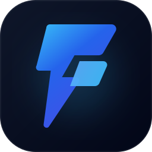

<div align="center">

  

  # Freelancer CRM ⚡

  **The keyboard-first, local-first CRM & project cockpit built specifically for solo operators.**

  [](./LICENSE)
  [](https://github.com/Olinkkt/freelancer-crm/actions)
  [](./docker-compose.yml)
  [](https://nextjs.org/)
  [](https://react.dev/)
  [](https://sqlite.org/)

  <p align="center">
    <a href="#-why-freelancer-crm">Why Freelancer CRM</a> •
    <a href="#-features">Key Features</a> •
    <a href="#-project-cockpit">Project Workspace</a> •
    <a href="#-keyboard-velocity">Keyboard Velocity</a> •
    <a href="#-quick-start">Quick Start</a> •
    <a href="#-docker--self-hosting">Self-Hosting</a> •
    <a href="#-license--faq">FAQ</a>
  </p>

  <br />

</div>

---

## 💡 Why Freelancer CRM?

Enterprise CRMs (HubSpot, Salesforce) are designed for 50-person sales departments with endless required fields, BDR SDR handoffs, and email tracking clutter. Generic task tools (Notion, Trello) lack cash flow tracking, invoice generation, and client sign-offs.

**Freelancer CRM** is tuned precisely around how solo developers, designers, and consultants actually close work and get paid:

$$\text{Quick Capture} \longrightarrow \text{Discovery} \longrightarrow \text{50\% Deposit} \longrightarrow \text{Milestone Sprints} \longrightarrow \text{Final Handover} \longrightarrow \text{Retainer Follow-up}$$

| Feature | Enterprise CRMs | Notion / Trello | Freelancer CRM |
| :--- | :---: | :---: | :---: |
| **Speed to capture lead** | 2–3 minutes (20 form fields) | ~1 minute (unstructured) | **< 5 seconds** (`N` key) |
| **50/50 Freelancer Invoicing** | ❌ Requires 3rd-party add-ons | ❌ Manual spreadsheets | **✅ Built-in 1-click generator** |
| **Project Milestones & Sign-off** | ❌ Disconnected from CRM | ⚠️ Manual checklist | **✅ Deep workspace with stage sync** |
| **Keyboard-first navigation** | ❌ Click-heavy | ⚠️ Partial shortcuts | **✅ Superhuman / Vim velocity** |
| **Data ownership & Privacy** | ❌ Cloud telemetry & lock-in | ❌ Proprietary cloud | **✅ 100% Local-first (SQLite/Docker)** |
| **Cost** | \$50–\$150 / user / mo | \$10–\$20 / mo | **Free & Open Source forever** |

---

## ⚡ Features

### 1. 🏎️ Superhuman-Grade Keyboard Velocity
Operate your entire freelance business without taking your hands off the keyboard:
- <kbd>N</kbd> — Quick-capture deals in under 5 seconds.
- <kbd>L</kbd> — Quick-log client calls and discovery meetings with slash templates (`/call`, `/meeting`, `/pricing`, `/tech`).
- <kbd>O</kbd> — Instant deep jump into the **Project Workspace** (`/deals/[id]`).
- <kbd>C</kbd> — Add new client contacts.
- <kbd>⌘</kbd> <kbd>K</kbd> or <kbd>Ctrl</kbd> <kbd>K</kbd> — Fuzzy command palette.
- <kbd>H</kbd> <kbd>J</kbd> <kbd>K</kbd> <kbd>L</kbd> or Arrow Keys — Vim-style column and card traversal.
- <kbd>G</kbd> <kbd>D</kbd>, <kbd>G</kbd> <kbd>C</kbd>, <kbd>G</kbd> <kbd>K</kbd>, <kbd>G</kbd> <kbd>S</kbd> — Instant view jumping (Deals, Companies, Contacts, Settings).

### 2. 💰 The Freelancer 50/50 Payment Rule
Cash flow kills solo businesses. Freelancer CRM enforces healthy invoicing by default:
- Automatically splits accepted quotes into **50% Upfront Deposit** and **50% Final Delivery** invoices.
- Marking the deposit as paid automatically advances the deal to **Won • Active Work**.
- Collecting the final invoice automatically moves the deal to **Paid • Delivered**.
- Generates 1-click shareable payment links and instant QR targets.

### 3. 🎯 Milestone Templates & Client Sign-Offs
- 1-click milestone presets for typical freelance contracts:
  - `+ Web Build (4 milestones)`: Architecture, Prototype, Integration, Handover.
  - `+ Brand & Identity (3 milestones)`: Strategy, Visual System, Guidelines.
  - `+ Monthly Retainer (3 milestones)`: Sprint Planning, Execution, Review.
- Client approval toggles with real-time progress percentages displayed directly on Kanban cards.

### 4. 🔄 Post-Delivery Momentum Engine
Prevent the feast-or-famine freelance cycle with automated high-leverage triggers:
- When a project is marked **Delivered**, the CRM offers 1-click high-converting follow-ups:
  - 🌟 *"Request Testimonial in 3 days"*
  - 💼 *"Pitch Monthly Retainer in 14 days"*
  - 🔍 *"Quarterly Check-in in 90 days"*

---

## 🖥️ Project Workspace

Press <kbd>O</kbd> on any deal or navigate to `/deals/[id]` to open the dedicated **Project Management Cockpit**:

- **Progressive Disclosure**: Use the fast Kanban drawer for daily pipeline triage; press <kbd>O</kbd> when doing deep project execution.
- **Auto-Syncing Markdown Notes**: Type checklist items (`- [ ]`) in the scratchpad and click **Sync Todos** to instantly register them into your global GTD follow-up inbox.
- **Invoicing & Milestone Hub**: Review payments, sign-offs, and client contacts in a full-width distraction-free view.

---

## ⌨️ Keyboard Velocity Cheat Sheet

| Shortcut | Action | Context |
| :--- | :--- | :--- |
| <kbd>N</kbd> | New Deal modal | Global |
| <kbd>L</kbd> | Log Activity / Meeting Notes | Global |
| <kbd>C</kbd> | Add Client Contact | Global |
| <kbd>O</kbd> | Open Project Workspace (`/deals/[id]`) | Kanban Drawer / Card |
| <kbd>⌘</kbd> <kbd>K</kbd> / <kbd>Ctrl</kbd> <kbd>K</kbd> | Command Palette | Global |
| <kbd>?</kbd> | Show Keyboard Shortcuts overlay | Global |
| <kbd>H</kbd> / <kbd>L</kbd> | Move cursor Left / Right across columns | Kanban Board |
| <kbd>J</kbd> / <kbd>K</kbd> | Move cursor Down / Up across deal cards | Kanban Board |
| <kbd>Enter</kbd> / <kbd>Space</kbd> | Open deal inspect drawer | Kanban Board |
| <kbd>G</kbd> then <kbd>D</kbd> | Jump to Deals board | Global |
| <kbd>G</kbd> then <kbd>C</kbd> | Jump to Companies list | Global |
| <kbd>G</kbd> then <kbd>K</kbd> | Jump to Contacts list | Global |
| <kbd>G</kbd> then <kbd>A</kbd> | Jump to Activity stream | Global |
| <kbd>G</kbd> then <kbd>S</kbd> | Jump to Settings | Global |
| <kbd>Esc</kbd> | Close any active modal or drawer | Global |

---

## 🚀 Quick Start

### Option A: 1-Line Docker Run (Recommended)

Run the entire CRM locally or on your VPS in under 30 seconds:

```bash
docker compose up -d
```

Open [http://localhost:3000](http://localhost:3000). Your SQLite database is persisted in `./data`.

---

### Option B: Local Development

#### 1. Clone & Install
```bash
git clone https://github.com/Olinkkt/freelancer-crm.git
cd freelancer-crm
pnpm install
```

#### 2. Environment Configuration
```bash
cp .env.example .env.local
```

Key configuration options:
```env
# Optional: Lock your CRM behind a passcode gate
AUTH_SECRET=your-secure-passcode

# Database: Defaults to local SQLite file
DATABASE_URL=file:./data/freelancercrm.db

# Operator Identity
NEXT_PUBLIC_OPERATOR_NAME="Alex Rivera"
NEXT_PUBLIC_OPERATOR_EMAIL="alex@example.com"
NEXT_PUBLIC_OPERATOR_ROLE="Full-Stack Engineer"

# Currency & Locale (supports USD $, EUR €, GBP £, CZK Kč, etc.)
NEXT_PUBLIC_DEFAULT_CURRENCY="USD"
NEXT_PUBLIC_CURRENCY_SYMBOL="$"
NEXT_PUBLIC_LOCALE="en-US"
```

#### 3. Run Dev Server
```bash
pnpm dev
```
Open [http://localhost:3000](http://localhost:3000).

#### 4. Run Automated Test Suite
```bash
pnpm test
```
*Passes all 62 unit & integration tests in under 15 seconds using Node.js native test runner.*

---

## 🐳 Self-Hosting & Deployment

### Production Docker Container
The Dockerfile uses multi-stage building with Next.js `standalone` output for an ultra-light image:

```bash
docker build -t freelancer-crm .
docker run -d -p 3000:3000 -v $(pwd)/data:/app/data freelancer-crm
```

### Deploy to Coolify / VPS
For zero-downtime deployment with automatic Let's Encrypt SSL, check out our complete [`DEPLOY.md`](./DEPLOY.md) guide.

---

## 🛠️ Tech Stack

- **Framework**: [Next.js 16](https://nextjs.org/) (App Router, Server Actions, React 19)
- **Styling**: [Tailwind CSS v4](https://tailwindcss.com/) & [Lucide Icons](https://lucide.dev/)
- **Database Engine**: [Kysely](https://kysely.dev/) with `@libsql/client` (SQLite) or `pg` (PostgreSQL)
- **Testing**: Node.js Native Test Runner with `tsx` & [Playwright](https://playwright.dev/)
- **Containerization**: Docker multi-stage standalone runner

---

## 📜 License & FAQ

This project is licensed under the **GNU Affero General Public License v3.0 (AGPL-3.0)**. See the [LICENSE](./LICENSE) file for complete terms.

### ❓ Frequently Asked Questions

<details>
<summary><b>Can I self-host this for my own freelance business for free?</b></summary>
<br>
<b>Yes, absolutely!</b> You have full freedom to self-host, run, and adapt Freelancer CRM for managing your clients, projects, and freelance revenue with zero licensing fees.
</details>

<details>
<summary><b>Can I make private modifications for my personal workflow?</b></summary>
<br>
<b>Yes.</b> Private modifications made for your own use do not require sharing source code or public distribution.
</details>

<details>
<summary><b>Why AGPL-3.0 instead of MIT?</b></summary>
<br>
AGPL-3.0 protects open-source software from being captured by proprietary cloud corporations who re-wrap open tools behind paid paywalls without contributing improvements back. It ensures Freelancer CRM remains free and open for the freelancer community forever.
</details>

---

## 🤝 Contributing

Contributions, bug reports, and feature proposals are welcome! Please read [`CONTRIBUTING.md`](./CONTRIBUTING.md) to get started.

<div align="center">
  <sub>Built with ⚡ for solo operators who value speed and craft.</sub>
</div>
