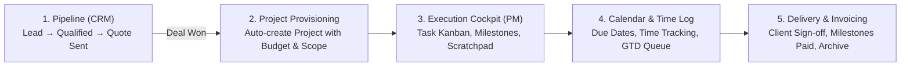
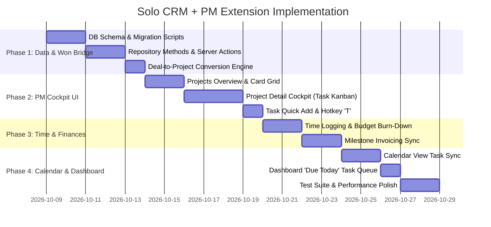

# Solo Freelancer CRM + Project Management: Extension Roadmap

> **Target Profile:** Single-operator cockpit ("Solo-Tenancy") for a creative/technical freelancer.
> **Philosophy:** Keyboard-first speed, GTD mandatory next actions, zero administrative friction, and a seamless "Lead-to-Cash" pipeline.
> **Reference Design:** Linear speed + Attio typography and calm surfaces (`DESIGN.md`).

---

## 1. Vision & Core Workflow: The "Lead-to-Cash" Operating System

Generic CRMs stop when a deal is won; generic project management tools don't know what client signed the contract or how much was billed. 

This extension bridges the two worlds into a single coherent lifecycle:



### Strategic Boundaries (What to Keep vs. What to Exclude)
* **Strictly Single-Tenant:** No multi-user permissions, no team roles (Admin/Member/Guest), no workspace invitation flows. Everything operates under the existing master passcode / session gate (`OperatorGate`).
* **Internal Cockpit Only:** This is Oliver's command center. External client portals, client magic links, and public client hubs are isolated to downstream consumers that can read from this database.
* **No Unnecessary Microservices:** Embedded SQLite / LibSQL for instant local dev & Coolify deployment; seamless fallback to PostgreSQL if configured via `DATABASE_URL`.

---

## 2. Existing Foundation to Leverage

The current codebase already possesses the high-performance primitives needed for this extension:

1. **Design System & Micro-Interactions (`DESIGN.md`):**
   - Cobalt blue accent (`#266df0`), ink typography (`#1c1d1f`), and 10px rounded interactive elements.
   - Attio-style compact tables, monospace tabular numbers (`font-mono tabular-nums`), and subtle blue-tinted elevation.
2. **Component Primitives:**
   - [`components/deals/deal-kanban.tsx`](file:///home/oliver/Code/Projects/freelancercrm/components/deals/deal-kanban.tsx): Reusable column dragging and stage-based categorization logic.
   - [`components/drawers/deliverables-tracker.tsx`](file:///home/oliver/Code/Projects/freelancercrm/components/drawers/deliverables-tracker.tsx): Milestone progress calculation and deposit invoice tracking.
   - [`components/drawers/scratchpad-editor.tsx`](file:///home/oliver/Code/Projects/freelancercrm/components/drawers/scratchpad-editor.tsx): Markdown editor with slash commands (`/call`, `/scope`, `/quote`, `/todo`).
   - [`components/calendar/calendar-view.tsx`](file:///home/oliver/Code/Projects/freelancercrm/components/calendar/calendar-view.tsx): Workweek day grid navigation and event slotting.
   - [`components/command-palette/command-palette.tsx`](file:///home/oliver/Code/Projects/freelancercrm/components/command-palette/command-palette.tsx): Keyboard-first (`Cmd+K`) action bar.
3. **Robust Backend:**
   - Type-safe database queries via **Kysely**.
   - 52 passing tests covering auth, repository CRUD, server actions, and CSV export.

---

## 3. Data Architecture Extension

### 3.1 Schema Normalization (`lib/db/schema.ts`)
Instead of burying deliverables inside stringified JSON on `deals`, we introduce dedicated `projects`, `tasks`, and `time_entries` tables.

```typescript
// --- 1. Projects Table ---
export interface ProjectTable {
  id: string
  deal_id: string | null             // Linked origin deal (if spawned from pipeline)
  company_id: string                // Linked client company
  title: string                     // e.g. "Brand Identity & Web Build"
  status: 'Planning' | 'Active' | 'Review' | 'Completed' | 'On Hold'
  budget: number                    // Total contract value in CZK (e.g. 75 000)
  currency: string                  // 'CZK'
  start_date: string | null         // YYYY-MM-DD
  target_end_date: string | null    // YYYY-MM-DD
  notes: string | null              // Internal project scratchpad / brief
  created_at: string
  updated_at: string
}

// --- 2. Tasks Table (Linear-style) ---
export interface TaskTable {
  id: string
  project_id: string
  title: string
  status: 'Backlog' | 'Todo' | 'In Progress' | 'Review' | 'Done'
  priority: 'urgent' | 'high' | 'medium' | 'low'
  due_date: string | null           // YYYY-MM-DD
  time_estimate_hours: number | null
  time_spent_hours: number | null
  client_sign_off: number           // 0 or 1
  order_index: number               // Position inside Kanban column
  created_at: string
  updated_at: string
}

// --- 3. Time Entries Table ---
export interface TimeEntryTable {
  id: string
  project_id: string
  task_id: string | null
  hours: number                     // e.g. 2.5
  hourly_rate: number               // e.g. 1 500 CZK
  billable: number                  // 0 or 1
  date: string                      // YYYY-MM-DD
  note: string | null
  created_at: string
}
```

### 3.2 Relational Integrity & Migration Path
* All existing deals with JSON `deliverables` will have a migration script to populate initial project/task records without losing data.
* Deleting a company or project safely cascades or unlinks associated tasks and time logs.

---

## 4. Step-by-Step Implementation Roadmap



### Phase 1: Schema Normalization & The "Won" Bridge
* **Goal:** Enable the database to store projects, tasks, and time entries, and automatically spawn projects when deals close.
* **Key Tasks:**
  1. Add `ProjectTable`, `TaskTable`, and `TimeEntryTable` to `lib/db/schema.ts` and initialize them in `lib/db/init.ts`.
  2. Implement repository functions in `lib/db/repository.ts`:
     - `createProject()`, `updateProject()`, `deleteProject()`, `getProjects()`
     - `createTask()`, `updateTask()`, `deleteTask()`, `moveTaskStatus()`, `reorderTasks()`
     - `logTime()`, `getTimeEntriesForProject()`
  3. Create the **Deal-to-Project Promotion Action**:
     - When `moveDealStageAction(dealId, 'Won')` fires, automatically provision a new `ProjectTable` record.
     - Convert all existing `deliverables` on the deal into `TaskTable` rows attached to the new project.
     - Pre-populate budget from deal's `raw_amount`.
  4. Write unit and integration tests in `tests/pm-repository.test.ts`.

### Phase 2: Project Cockpit & Task Management UI
* **Goal:** Provide a responsive, high-speed project interface matching the Linear/Attio look and feel.
* **Key Tasks:**
  1. **Sidebar Navigation Update:** Add a `"Projects"` tab with an active count badge in `app/page.tsx`.
  2. **Projects View Mode (`activeView === 'Projects'`):**
     - Metric cards: *Active Projects*, *Total In-Flight Value*, *Hours Logged This Month*, *Overdue Milestones*.
     - Project Cards: Client badge, budget progress, completion bar, target deadline, and next milestone.
  3. **Project Cockpit Drawer / Dedicated View:**
     - **Tab 1: Task Board (Kanban):** Columns for `Backlog`, `Todo`, `In Progress`, `Review`, `Done`. Drag-and-drop or quick hotkeys to advance tasks.
     - **Tab 2: Deliverables & Milestones:** Checkbox tree with client sign-off indicators.
     - **Tab 3: Notes & Scratchpad:** Project-scoped markdown scratchpad reusing `ScratchpadEditor`.
     - **Tab 4: Invoices & Cashflow:** Milestone deposit tracker (50% upfront, 50% on completion).
  4. **Task Hotkey (`T`):** Single-key modal/drawer to instantly log a task to any active project without clicking.

### Phase 3: Time Tracking & Project Budget Health
* **Goal:** Prevent scope creep and track real hourly yield on fixed-price projects.
* **Key Tasks:**
  1. Add a compact **Time Entry Modal** (or running stopwatch timer in the top bar).
  2. Display **Budget Health Indicator**:
     - Compares logged hours $\times$ hourly rate against fixed project price.
     - Visual warning if actual hours exceed the scoped quote.
  3. Tie milestone invoicing status (`Draft` $\rightarrow$ `Sent` $\rightarrow$ `Paid`) directly to task completions.

### Phase 4: Unified Calendar & Dashboard Cockpit
* **Goal:** One single screen to see both client sales meetings and project execution deadlines.
* **Key Tasks:**
  1. **Calendar Sync:** Update `components/calendar/calendar-view.tsx` to display:
     - CRM Activities (discovery calls, meetings) in Blue/Violet.
     - Project Milestones & Task Deadlines in Green/Amber.
  2. **Dashboard GTD Queue:**
     - The Dashboard currently has a "Follow-ups" list. Augment this into a unified **"Today's Focus"** list displaying both client follow-ups and high-priority tasks due today.
  3. **Command Palette (`Cmd+K`) Expansion:**
     - Search projects by client or title.
     - Quick actions: "Add task to [Project]", "Log 2h on [Project]", "Mark milestone completed".

### Phase 5: Verification & TDD Hardening
* **Goal:** Guarantee rock-solid stability and zero regressions.
* **Key Tasks:**
  1. Add end-to-end API and server action tests in `tests/pm-actions.test.ts`.
  2. Test edge cases: Deleting a deal after project creation, project archiving, negative hours, currency formatting.
  3. Verify keyboard chord navigation (`G P` for Projects, `T` for Task, `N` for Deal, `L` for Call).

---

## 5. Keyboard Navigation Map

| Shortcut | Scope | Action |
| :--- | :--- | :--- |
| `Cmd+K` / `Ctrl+K` | Global | Open global command palette |
| `G` $\rightarrow$ `D` | Global | Jump to Dashboard |
| `G` $\rightarrow$ `P` | Global | Jump to Deals & Pipeline |
| `G` $\rightarrow$ `R` | Global | Jump to Projects & PM Cockpit |
| `G` $\rightarrow$ `C` | Global | Jump to Companies |
| `G` $\rightarrow$ `K` | Global | Jump to Calendar |
| `N` | Global | Quick capture new Deal |
| `T` | Global | Quick capture new Task |
| `L` | Global | Quick log Call / Meeting note |
| `Esc` | Modal/Drawer | Close open sheet / return to stage |

---

## 6. Execution Strategy

To execute this roadmap efficiently without breaking the working app:

1. **Step-by-step implementation:** Follow Test-Driven Development (TDD) for every database and server action change.
2. **Preserve existing CRM functionality:** All 52 existing tests must continue passing at every step.
3. **Component reusability:** Reuse existing UI styles and utility functions in `lib/date-utils.ts` and `DESIGN.md`.
