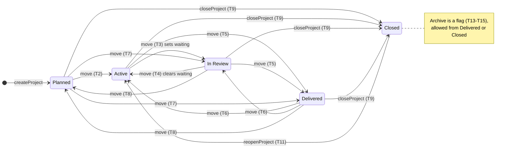
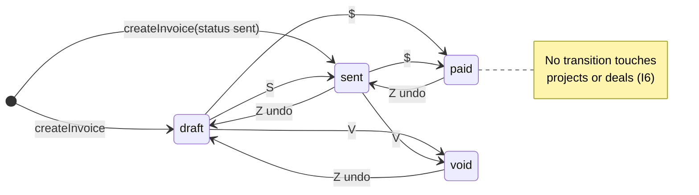

# Build spec: Projects for Freelancer CRM

| | |
|---|---|
| **Repo** | `github.com/Olinkkt/freelancer-crm`, base `main` @ `0da64e8` |
| **Status** | Ready to implement. All decisions are final (see §5). There are no open questions. |
| **Audience** | An autonomous coding agent. Follow the sections in order. When the spec and the code disagree, the spec wins, unless the spec quotes code that has since changed; in that case adapt and note it in the PR description. |
| **Size** | 6 PRs, merged in order (§13). Each PR is independently shippable and green on CI. |

**Sections:** 1 Goal · 2 Non-goals · 3 Glossary · 4 Conventions · 5 Decisions log · 6 Baseline · 7 Data model · 8 Domain rules · 9 Server actions and API · 10 Shortcuts · 11 Screens · 12 Flows · 13 PR plan · 14 Definition of done and manual QA · 15 Agent kickoff prompt

---

## 1. Goal

Give a solo freelancer (designer, developer, writer or consultant) a minimal, keyboard-first way to **deliver** the work they **sell** in the CRM:

1. A won deal becomes a **project** with one keystroke.
2. Each project has **stages** (Planned → Active → In Review → Delivered → Closed), **milestones**, **tasks** and **invoices** (tracker only).
3. A **Today** view (the new landing view) answers "what do I do now?" across all projects.
4. Client feedback becomes **revision tasks**. Milestones produce **invoice** suggestions. Nothing changes state silently.
5. All shortcuts come from **one registry**, are **user-customisable**, and generate the README table.
6. The legacy JSON deliverables/invoices feature and the `Paid` deal stage are removed, and existing data is migrated losslessly.

## 2. Non-goals

These are explicitly out of scope. Do not build them, and do not leave TODOs for them.

| Non-goal | Why |
|---|---|
| Time tracking, timers, timesheets | The CRM has none. Hourly work records hours **only when billing** (`invoices.hours`). |
| Sprints, Gantt charts, dependencies, subtasks, assignees, team features | CONTRIBUTING rule 1 (solo tenancy) and minimal scope. |
| **Invoice generation**: PDFs, invoice numbering, tax/VAT, sending emails, payment processing | Invoices are a **tracker** that points to the user's accounting tool (`number` and `external_url` are user-entered). |
| **Multiple projects per deal** | `projects.deal_id` is unique. Phase 2 of a client engagement = a **new deal** → a new project. |
| Recurring automation (cron, auto-created retainer invoices) | Retainers add the next month manually with `Shift+M`. |
| Client portal or client-facing views | `IDEAS.md`: the portal is a separate downstream project. Milestone `approved_at` is its hook. |
| Migrating `follow_ups.day` to ISO dates | Follow-ups keep their existing string buckets and `isDueToday()`. |
| Dropping the legacy `deals.deliverables` / `deals.invoices` columns | Kept unused for one release as a rollback path. Dropping them is a separate later PR. |
| A "Lost" deal stage | Not in `DealStage` today. Unknown stages are normalised (§7.7). |
| Multi-instance Postgres migration locking | Solo, single-process deployment. |
| Mobile-native gestures | The layouts are responsive (§11), but keyboard and mouse are the input model. |

## 3. Glossary (one name per concept)

| Term | Meaning | Code name |
|---|---|---|
| **Deal** | A sales opportunity. Stages: `Lead → Qualified → Proposal → Won`. | `Deal`, table `deals` |
| **Project** | Delivery of one deal (or standalone work). At most one per deal. | `Project`, `projects` |
| **Stage** | A user-named project column, e.g. "In Review". | `ProjectStage`, `project_stages` |
| **Stage category** | One of five fixed behaviours behind a stage: `planned`, `active`, `review`, `delivered`, `closed`. | `StageCategory` |
| **Milestone** | A deliverable checkpoint of a project, optionally billable. Status `open → delivered → approved`. | `Milestone`, `project_milestones` |
| **Task** | A to-do inside a project, optionally under a milestone. | `Task`, `project_tasks` |
| **Revision task** | A task created from client feedback (`kind = 'revision'`, with a `revision_round`). | |
| **Invoice** | A tracked invoice row (tracker only). Status `draft → sent → paid` (or `void`). **Overdue** is computed, never stored. | `Invoice`, `invoices` |
| **Template** | A reusable blueprint of milestones, tasks and a payment schedule. Applying it copies rows. | `ProjectTemplate`, `project_templates` |
| **Payment schedule** | How invoices are pre-created at project start. | `PaymentSchedule` |
| **Due date** | A hard deadline (`due_date`). | |
| **Focus date** | "I plan to do it on…" (`focus_date`). Pinning (`F`) sets it to today. | |
| **Waiting** | A project waiting on the client (`waiting_since_date` is set). | |
| **Next step** | An open task with a due date or focus date. An `active` project without one is flagged. This is the project equivalent of a deal's **next action**. | `needsNextStep` |
| **Next action** | The existing deal GTD field (`deals.next`). Required for deals in Lead, Qualified and Proposal. | |
| **Suggestion** | A proposed follow-up action returned by a server action and shown as a toast. Only runs when the user presses `Y` or clicks. | `Suggestion` |
| **Shortcut registry** | The single source of truth for every keyboard shortcut. | `SHORTCUTS` in `lib/shortcuts/registry.ts` |
| **Scope / context** | Scope: the place a shortcut belongs (`list`, `board`, …). Context: the set of scopes that are active at the same time. | `ShortcutScope`, `ShortcutContext` |
| **Minor units** | Money stored as an integer = amount × 100. | `*_minor` columns |
| **ISO date / timestamp** | `YYYY-MM-DD` (columns named `*_date`) / `new Date().toISOString()` (columns named `*_at`). | `IsoDate`, `IsoTimestamp` |

## 4. Conventions

**Product rules (CONTRIBUTING.md)**
1. **Every user action in this spec has a registry shortcut** (§10.3). A PR that adds a button without a registry entry is incomplete.
2. **Mandatory next action on deals stays.** Lead, Qualified and Proposal deals still require `next`. Won deals hand off to their project: a Won deal *with* a project is exempt (the project's **next step** rule applies instead), and a Won deal *without* one shows the computed next action "Start project".
3. **Tests in every PR** (`node:test` + `tsx`, files in `tests/*.test.ts`, run by `pnpm test` against `data/test.db`). CI = `pnpm test` + `pnpm build`.
4. Focused PRs and **Conventional Commits** (`feat(projects): …`, `fix(deals): …`, `refactor(shortcuts): …`).
5. Local-first: SQLite by default, Postgres optional, under 150 MB RAM. No new runtime services.

**Code style (match the repo)**
- TypeScript strict, 2-space indent, single quotes, **no semicolons**, trailing commas in multiline literals, named exports, the `@/` path alias.
- Client components start with `'use client'`; server action files start with `'use server'` and export **only async functions**. Helpers go in `lib/`.
- DB rows are `snake_case` (Kysely types in `lib/db/schema.ts`). Domain objects are `camelCase` (`lib/projects/types.ts`). Map them in the repository layer with `mapXRow()` functions, like `mapDealRow`.
- IDs come from the existing `generateId(prefix)` (`lib/db/repository.ts:28`). Move it to `lib/db/ids.ts` and export it. Prefixes: `prj`, `stg`, `ms`, `tsk`, `inv`, `tpl`.
- UI: reuse `app/globals.css` classes (`.panel`, `.page-heading`, `.eyebrow`, `.stage-pill`, `.deal-row`, `.nav-item`) and the tokens in `DESIGN.md` (cobalt `#266df0`, graphite `#232529`, 10px radii). Use the components in `components/ui/*` (`Button`, `Combobox`, `RowActionMenu`, `ToastHUD`, `MarkdownFormatter`) and `lucide-react` icons. Do not add a UI library.
- Copy: plain words, no jargon (issues #25 and #33). Use "Project", "Milestone", "Task", "Invoice", "Waiting on client".
- Never fabricate data. No placeholder emails, payment links or amounts. Empty means empty.
- Hooks are always above early returns (the lesson from issue #31).

## 5. Decisions log

| # | Decision | Rationale |
|---|---|---|
| D1 | **Retire the `Paid` deal stage**: migrate it to `Won`, with no alias. | Sales ends at Won; payment lives on invoices. (Decided by the user.) |
| D2 | **Today is the default view** (`/` = `/?view=today`). Dashboard stays at `G D`. | Decided by the user. |
| D3 | **One central shortcut registry** renders the help modal, the settings screen and the README table. A test fails when the README drifts. | Decided by the user. |
| D4 | **Shortcut overrides are stored in the DB** (`workspace_settings.shortcut_overrides`, JSON) **rather than localStorage**. | It's one user on several browsers/devices; overrides are included in backup/restore; the bindings arrive with the workspace payload, so there's no flash of defaults; and the existing passcode flow already guards the settings row. |
| D5 | Only **overrides** are stored (a diff from the defaults). | New defaults in later releases reach users who didn't rebind that action. |
| D6 | **`G P` stays Deals ("Pipeline"). Projects = `G J` ("Jobs").** The README is corrected to the code's existing chords (`G D` Dashboard, `G U` Contacts, `G K` Calendar). | `G P` is in CONTRIBUTING and in muscle memory. `J` is free and mnemonic. Users can rebind. |
| D7 | **Board column navigation = `←`/`→` only.** `H`/`L`, `Shift+H`/`Shift+L` and `Tab` column cycling are removed from the board. | Existing bug: on the Deals board `L` both moved focus and opened Log activity (global `L`). `Tab` stays native focus movement (reserved). With the registry, conflicts are impossible by construction. |
| D8 | Suggestions are accepted with **`Y`** and actions undone with **`Z`** (global, only while a matching toast is visible). | `Enter` is taken by lists and boards. Single keys keep it keyboard-first. |
| D9 | **Invoices are a tracker**: `number`, `label`, `amount_minor`, `currency`, `status`, `issue_date`, `due_date`, `paid_date`, `external_url`, `hours`, `notes`. | Decided by the user. |
| D10 | **One project per deal** (`UNIQUE(deal_id)`). Deleting a deal keeps its project (`deal_id → NULL`). | Decided by the user. |
| D11 | Money is an **INTEGER in minor units** (× 100), with a per-invoice and per-project `currency` (ISO 4217) defaulting to the workspace currency. | No float drift. INTEGER (not BIGINT) because `pg` returns BIGINT as a string. The cap is 2,000,000,000 minor units, validated. |
| D12 | **Stage categories are fixed, stage names are editable.** Moves between non-closed stages are free. **Entering `closed` only happens through `closeProjectAction`**, and leaving it only through `reopenProjectAction`. Archive is a flag, allowed from `delivered` or `closed`. | Minimal and predictable. The money check lives in one place. |
| D13 | **Server actions return `ActionResult<T>`** instead of throwing. | Next.js redacts thrown server-action errors in production, so the UI needs stable error codes. Existing deal actions are left as they are. |
| D14 | **`today` is passed in by the client** (`YYYY-MM-DD` in the browser's timezone) to every date-sensitive read. | A server running in UTC would otherwise flip "today" at the wrong hour. |
| D15 | No FOREIGN KEY constraints. The repository enforces integrity and cascades inside transactions. | Matches the existing schema, keeps restore order simple, and avoids SQLite's per-connection `PRAGMA foreign_keys`. |
| D16 | Migrations: a versioned ledger table `schema_migrations` and ordered TypeScript migrations. The current DDL becomes migration 001 unchanged (idempotent `IF NOT EXISTS`), so existing DBs upgrade cleanly. | Today there's only `CREATE TABLE IF NOT EXISTS` plus an in-memory version number. |
| D17 | Activities gain a nullable `project_id`. | Feedback, nudges and close notes belong to a project even without a deal. |
| D18 | Positions are a REAL (SQLite) / DOUBLE PRECISION (Postgres) **fractional index** with a step of 1024, renormalised when the gap is under 1e-6. | A reorder is one row write. |
| D19 | Rebinding **replaces all bindings** of an action with the single recorded binding. Reset restores the defaults (which may be two bindings). | Simple UI, no "alternatives" editor. |
| D20 | The old deal-workspace tab "Scope & Deliverables" is replaced by the **deal project card** (`DealProjectCard`). The deal's markdown `notes` stays sales notes; legacy migration **copies** it into the project brief. | Deals sell and projects deliver; no data loss. |
| D21 | `Discovery` → `Qualified` and any other unknown deal stage (e.g. `Lost`) → `Lead`, with an activity noting the change. The zod deal enum is fixed to the 4 real stages. | `lib/validations/index.ts:135` currently allows non-existent stages. |
| D22 | **Projects board** list mode is sorted by due date (no sort control). | Minimal: one sort that's useful. |

## 6. Baseline: what exists and what is replaced

Audit evidence is in `archive/pm-flows.v1-design.md` §1. Here is a summary of the code this feature **removes or rewires**:

| Location | Today | After |
|---|---|---|
| `lib/db/schema.ts:52-53`, `lib/crm-types.ts:16-38` | `deals.deliverables` / `deals.invoices` JSON blobs; `DeliverableItem`, `InvoiceMilestone` | Tables in §7. The legacy types move to `lib/projects/legacy.ts` (migration only). The columns stay unused in the DB. |
| `components/drawers/deliverables-tracker.tsx` (604 lines) | Click-to-cycle status, hard-coded templates, fake Fakturoid link (`:164`), deposit paid → stage Won (`:186-191`, **#34**), `paidAt: 'Just now'` | Read-only in PR 1 (all writes and cascades removed), **deleted** in PR 5. |
| `lib/db/repository.ts:614-682` `moveDealStage` | Marks deliverables Done on Paid | Stage + probability only. |
| `app/page.tsx:691-768` `handleMoveDealStage` | Client-side cascades; completes follow-ups in state only | Calls `moveDealStageAction`; shows the "Start project" suggestion on Won. |
| `components/drawers/deal-detail-drawer.tsx:153-185, 440-532, 578-626, 853-870` | A second stage implementation, "Settle & Complete All", hard-coded `formatMoney(8000)`, the tracker tab | Uses `moveDealStageAction`. `DealProjectCard` replaces the tab (PR 5). The other three are deleted (PR 1). |
| `app/deals/[id]/page.tsx:111, 315, 166-183, 338, 497-514, 800` | Invented `contact@….cz`, a third stage implementation, dead breadcrumbs, tracker mount + stale-closure race | Contact shown only if real; one stage path; `/?view=deals` breadcrumbs; `DealProjectCard`. |
| `app/page.tsx:263-394`, `components/deals/deal-kanban.tsx:255-330`, drawer `:120-140`, `components/modals/shortcuts-modal.tsx` | Four hand-written `keydown` listeners; the README disagrees with the code | `ShortcutProvider` + `useShortcut()` from the registry. |
| `lib/validations/index.ts:47-48, 135` | `z.array(z.any())`; stage enum with `Discovery`/`Lost` | Strict schemas; `DealStage` enum. |
| `Paid` references | `lib/crm-types.ts`, `lib/validations/index.ts`, `lib/db/repository.ts`, `components/deals/{deal-kanban,types,deal-next-action-cell}.tsx`, `components/modals/new-deal-modal.tsx`, `components/command-palette/command-palette.tsx`, `components/calendar/calendar-view.tsx`, `app/page.tsx`, `app/deals/[id]/page.tsx`, `components/drawers/*`, `tests/stage-probability.test.ts`, `tests/repository.test.ts` | All removed in PR 1 (§13). |

## 7. Data model

### 7.1 Enums (`lib/projects/constants.ts`; DB enforces them with CHECK constraints)

```ts
export const STAGE_CATEGORIES = ['planned', 'active', 'review', 'delivered', 'closed'] as const
export const BILLING_TYPES = ['fixed', 'hourly', 'retainer'] as const
export const MILESTONE_STATUSES = ['open', 'delivered', 'approved'] as const
export const TASK_KINDS = ['task', 'revision'] as const
export const INVOICE_STATUSES = ['draft', 'sent', 'paid', 'void'] as const
export const PROJECT_HEALTH = ['on_track', 'at_risk', 'blocked'] as const
export const CLOSE_OUTCOMES = ['completed', 'cancelled'] as const
export const PAYMENT_SCHEDULES = ['none', 'upfront_100', 'split_50_50', 'split_30_40_30', 'per_milestone', 'monthly'] as const
export const FEEDBACK_SOURCES = ['Email', 'Call', 'Meeting', 'Note'] as const // existing activity types

export type StageCategory = (typeof STAGE_CATEGORIES)[number]
export type BillingType = (typeof BILLING_TYPES)[number]
export type MilestoneStatus = (typeof MILESTONE_STATUSES)[number]
export type TaskKind = (typeof TASK_KINDS)[number]
export type InvoiceStatus = (typeof INVOICE_STATUSES)[number]
export type ProjectHealth = (typeof PROJECT_HEALTH)[number]
export type CloseOutcome = (typeof CLOSE_OUTCOMES)[number]
export type PaymentSchedule = (typeof PAYMENT_SCHEDULES)[number]
export type FeedbackSource = (typeof FEEDBACK_SOURCES)[number]

export const DEAL_STAGES = ['Lead', 'Qualified', 'Proposal', 'Won'] as const // 'Paid' removed (D1)
export const MAX_MINOR = 2_000_000_000
export const POSITION_STEP = 1024
```

Seeded default stages (id → name → category → position → color):

| id | name | category | position | color |
|---|---|---|---|---|
| `stg-planned` | Planned | planned | 1 | `gray` |
| `stg-active` | Active | active | 2 | `blue` |
| `stg-review` | In Review | review | 3 | `amber` |
| `stg-delivered` | Delivered | delivered | 4 | `violet` |
| `stg-closed` | Closed | closed | 5 | `green` |

Stage ordering on boards and for `[`/`]` = category order (as in `STAGE_CATEGORIES`), then `position`.

### 7.2 Kysely types (`lib/db/schema.ts`, additions and changes)

```ts
import type { ColumnType } from 'kysely'
import type {
  StageCategory, BillingType, MilestoneStatus, TaskKind, InvoiceStatus,
  ProjectHealth, CloseOutcome, PaymentSchedule,
} from '@/lib/projects/constants'

export type IsoDate = string // 'YYYY-MM-DD'
export type IsoTimestamp = string // Date#toISOString()
type CreatedAt = ColumnType<IsoTimestamp, IsoTimestamp, never>

export interface SchemaMigrationsTable {
  version: number
  name: string
  applied_at: IsoTimestamp
}

export interface ProjectStagesTable {
  id: string
  name: string
  category: StageCategory
  position: number
  color: string
  created_at: CreatedAt
  updated_at: IsoTimestamp
}

export interface ProjectsTable {
  id: string
  title: string
  company: string
  company_id: string | null
  deal_id: string | null
  contact_name: string | null
  contact_email: string | null
  stage_id: string
  billing_type: BillingType
  currency: string
  budget_minor: number | null
  hourly_rate_minor: number | null
  estimate_hours: number | null
  revisions_included: number | null
  start_date: IsoDate | null
  due_date: IsoDate | null
  waiting_since_date: IsoDate | null
  health: ProjectHealth | null
  brief: string
  template_id: string | null
  close_outcome: CloseOutcome | null
  close_reason: string | null
  stage_changed_at: IsoTimestamp
  delivered_at: IsoTimestamp | null
  closed_at: IsoTimestamp | null
  archived_at: IsoTimestamp | null
  created_at: CreatedAt
  updated_at: IsoTimestamp
}

export interface ProjectMilestonesTable {
  id: string
  project_id: string
  title: string
  position: number
  due_date: IsoDate | null
  amount_minor: number | null
  status: MilestoneStatus
  delivered_at: IsoTimestamp | null
  approved_at: IsoTimestamp | null
  created_at: CreatedAt
  updated_at: IsoTimestamp
}

export interface ProjectTasksTable {
  id: string
  project_id: string
  milestone_id: string | null
  title: string
  notes: string | null
  kind: TaskKind
  revision_round: number | null
  source_activity_id: string | null
  due_date: IsoDate | null
  focus_date: IsoDate | null
  position: number
  completed_at: IsoTimestamp | null
  created_at: CreatedAt
  updated_at: IsoTimestamp
}

export interface InvoicesTable {
  id: string
  project_id: string
  milestone_id: string | null
  number: string | null
  label: string
  amount_minor: number
  currency: string
  hours: number | null
  status: InvoiceStatus
  issue_date: IsoDate | null
  due_date: IsoDate | null
  paid_date: IsoDate | null
  external_url: string | null
  notes: string | null
  created_at: CreatedAt
  updated_at: IsoTimestamp
}

export interface ProjectTemplatesTable {
  id: string
  name: string
  billing_type: BillingType
  payment_schedule: PaymentSchedule
  duration_days: number | null
  revisions_included: number | null
  milestones_json: string // JSON TemplateMilestone[] (zod: templateMilestoneSchema)
  tasks_json: string // JSON TemplateTask[] (zod: templateTaskSchema)
  is_builtin: number // 0 | 1
  position: number
  created_at: CreatedAt
  updated_at: IsoTimestamp
}

// CHANGED
export interface WorkspaceSettingsTable {
  /* …existing columns unchanged… */
  invoice_net_days: number // default 14
  last_weekly_review_at: IsoTimestamp | null
  shortcut_overrides: string // JSON ShortcutOverrides, default '{}'
}
export interface ActivitiesTable {
  /* …existing columns unchanged… */
  project_id: string | null
}
export interface DealsTable {
  /* …existing… */
  /** @deprecated legacy, read only by migration 003; never written */
  deliverables: string | null
  /** @deprecated legacy, read only by migration 003; never written */
  invoices: string | null
}

export interface Database {
  /* …existing tables… */
  schema_migrations: SchemaMigrationsTable
  project_stages: ProjectStagesTable
  projects: ProjectsTable
  project_milestones: ProjectMilestonesTable
  project_tasks: ProjectTasksTable
  invoices: InvoicesTable
  project_templates: ProjectTemplatesTable
}
```

### 7.3 SQL: SQLite (libsql)

```sql
CREATE TABLE IF NOT EXISTS schema_migrations (
  version INTEGER PRIMARY KEY,
  name TEXT NOT NULL,
  applied_at TEXT NOT NULL
);

CREATE TABLE project_stages (
  id TEXT PRIMARY KEY,
  name TEXT NOT NULL CHECK (length(trim(name)) BETWEEN 1 AND 40),
  category TEXT NOT NULL CHECK (category IN ('planned','active','review','delivered','closed')),
  position INTEGER NOT NULL,
  color TEXT NOT NULL DEFAULT 'blue',
  created_at TEXT NOT NULL,
  updated_at TEXT NOT NULL
);

CREATE TABLE projects (
  id TEXT PRIMARY KEY,
  title TEXT NOT NULL CHECK (length(trim(title)) BETWEEN 1 AND 200),
  company TEXT NOT NULL,
  company_id TEXT,
  deal_id TEXT UNIQUE,
  contact_name TEXT,
  contact_email TEXT,
  stage_id TEXT NOT NULL,
  billing_type TEXT NOT NULL DEFAULT 'fixed' CHECK (billing_type IN ('fixed','hourly','retainer')),
  currency TEXT NOT NULL CHECK (length(currency) = 3),
  budget_minor INTEGER CHECK (budget_minor IS NULL OR budget_minor >= 0),
  hourly_rate_minor INTEGER CHECK (hourly_rate_minor IS NULL OR hourly_rate_minor >= 0),
  estimate_hours REAL CHECK (estimate_hours IS NULL OR estimate_hours >= 0),
  revisions_included INTEGER CHECK (revisions_included IS NULL OR revisions_included >= 0),
  start_date TEXT,
  due_date TEXT,
  waiting_since_date TEXT,
  health TEXT CHECK (health IS NULL OR health IN ('on_track','at_risk','blocked')),
  brief TEXT NOT NULL DEFAULT '',
  template_id TEXT,
  close_outcome TEXT CHECK (close_outcome IS NULL OR close_outcome IN ('completed','cancelled')),
  close_reason TEXT,
  stage_changed_at TEXT NOT NULL,
  delivered_at TEXT,
  closed_at TEXT,
  archived_at TEXT,
  created_at TEXT NOT NULL,
  updated_at TEXT NOT NULL,
  CHECK (due_date IS NULL OR start_date IS NULL OR due_date >= start_date)
);

CREATE TABLE project_milestones (
  id TEXT PRIMARY KEY,
  project_id TEXT NOT NULL,
  title TEXT NOT NULL CHECK (length(trim(title)) BETWEEN 1 AND 200),
  position REAL NOT NULL,
  due_date TEXT,
  amount_minor INTEGER CHECK (amount_minor IS NULL OR amount_minor >= 0),
  status TEXT NOT NULL DEFAULT 'open' CHECK (status IN ('open','delivered','approved')),
  delivered_at TEXT,
  approved_at TEXT,
  created_at TEXT NOT NULL,
  updated_at TEXT NOT NULL,
  CHECK (status <> 'approved' OR approved_at IS NOT NULL)
);

CREATE TABLE project_tasks (
  id TEXT PRIMARY KEY,
  project_id TEXT NOT NULL,
  milestone_id TEXT,
  title TEXT NOT NULL CHECK (length(trim(title)) BETWEEN 1 AND 500),
  notes TEXT,
  kind TEXT NOT NULL DEFAULT 'task' CHECK (kind IN ('task','revision')),
  revision_round INTEGER CHECK (revision_round IS NULL OR revision_round >= 1),
  source_activity_id TEXT,
  due_date TEXT,
  focus_date TEXT,
  position REAL NOT NULL,
  completed_at TEXT,
  created_at TEXT NOT NULL,
  updated_at TEXT NOT NULL,
  CHECK (kind = 'revision' OR revision_round IS NULL)
);

CREATE TABLE invoices (
  id TEXT PRIMARY KEY,
  project_id TEXT NOT NULL,
  milestone_id TEXT,
  number TEXT,
  label TEXT NOT NULL CHECK (length(trim(label)) BETWEEN 1 AND 200),
  amount_minor INTEGER NOT NULL CHECK (amount_minor BETWEEN 0 AND 2000000000),
  currency TEXT NOT NULL CHECK (length(currency) = 3),
  hours REAL CHECK (hours IS NULL OR hours >= 0),
  status TEXT NOT NULL DEFAULT 'draft' CHECK (status IN ('draft','sent','paid','void')),
  issue_date TEXT,
  due_date TEXT,
  paid_date TEXT,
  external_url TEXT,
  notes TEXT,
  created_at TEXT NOT NULL,
  updated_at TEXT NOT NULL,
  CHECK (status <> 'paid' OR paid_date IS NOT NULL),
  CHECK (status NOT IN ('sent','paid') OR issue_date IS NOT NULL)
);

CREATE TABLE project_templates (
  id TEXT PRIMARY KEY,
  name TEXT NOT NULL CHECK (length(trim(name)) BETWEEN 1 AND 80),
  billing_type TEXT NOT NULL CHECK (billing_type IN ('fixed','hourly','retainer')),
  payment_schedule TEXT NOT NULL DEFAULT 'none'
    CHECK (payment_schedule IN ('none','upfront_100','split_50_50','split_30_40_30','per_milestone','monthly')),
  duration_days INTEGER CHECK (duration_days IS NULL OR duration_days >= 0),
  revisions_included INTEGER CHECK (revisions_included IS NULL OR revisions_included >= 0),
  milestones_json TEXT NOT NULL DEFAULT '[]',
  tasks_json TEXT NOT NULL DEFAULT '[]',
  is_builtin INTEGER NOT NULL DEFAULT 0 CHECK (is_builtin IN (0,1)),
  position INTEGER NOT NULL,
  created_at TEXT NOT NULL,
  updated_at TEXT NOT NULL
);

ALTER TABLE workspace_settings ADD COLUMN invoice_net_days INTEGER NOT NULL DEFAULT 14;
ALTER TABLE workspace_settings ADD COLUMN last_weekly_review_at TEXT;
ALTER TABLE workspace_settings ADD COLUMN shortcut_overrides TEXT NOT NULL DEFAULT '{}';
ALTER TABLE activities ADD COLUMN project_id TEXT;

CREATE INDEX IF NOT EXISTS idx_projects_stage ON projects(archived_at, stage_id);
CREATE INDEX IF NOT EXISTS idx_projects_company ON projects(company);
CREATE INDEX IF NOT EXISTS idx_milestones_project ON project_milestones(project_id, position);
CREATE INDEX IF NOT EXISTS idx_tasks_project ON project_tasks(project_id, completed_at, position);
CREATE INDEX IF NOT EXISTS idx_tasks_due ON project_tasks(completed_at, due_date);
CREATE INDEX IF NOT EXISTS idx_tasks_focus ON project_tasks(completed_at, focus_date);
CREATE INDEX IF NOT EXISTS idx_invoices_project ON invoices(project_id);
CREATE INDEX IF NOT EXISTS idx_invoices_status_due ON invoices(status, due_date);
CREATE INDEX IF NOT EXISTS idx_activities_project ON activities(project_id);
```

### 7.4 SQL: Postgres

This is identical to §7.3 except for **these type substitutions**. Everything else (CHECKs, `UNIQUE`, the `ALTER`s, indexes) is portable as written. `length()` and `trim()` exist in both.

| Column | SQLite | Postgres |
|---|---|---|
| `project_milestones.position`, `project_tasks.position` | `REAL` | `DOUBLE PRECISION` |
| `projects.estimate_hours`, `invoices.hours` | `REAL` | `DOUBLE PRECISION` |

Implement this with one helper in `lib/db/migrations/sql.ts`: `export const floatType = (d: SqlDialect) => (d === 'postgres' ? 'DOUBLE PRECISION' : 'REAL')`, interpolated with `sql.raw()`. Every other type is `TEXT` / `INTEGER` in both dialects, as in the existing `init.ts`.

### 7.5 Constraints and invariants enforced in code (`lib/db/projects-repository.ts`)

| # | Invariant | Enforced by | Error code |
|---|---|---|---|
| I1 | At most one project per deal | `UNIQUE(deal_id)` + a pre-check | `DEAL_ALREADY_HAS_PROJECT` (includes `projectId`) |
| I2 | `stage_id` references an existing stage | Repository check | `NOT_FOUND` |
| I3 | `milestone_id` on a task/invoice belongs to the same project | Repository check | `VALIDATION` |
| I4 | Entering or leaving `closed` only via close/reopen | `planStageChange()` | `USE_CLOSE_PROJECT` / `USE_REOPEN_PROJECT` |
| I5 | Archive only when the category is `delivered` or `closed` | Repository check | `ARCHIVE_NOT_ALLOWED` |
| I6 | **Invoice status changes never modify `projects` or `deals`** (#34) | Code review + test `invoice-paid-never-changes-stage` | — |
| I7 | Every category keeps ≥1 stage; a stage with projects can't be deleted without a target | Repository check | `LAST_STAGE_IN_CATEGORY` / `STAGE_IN_USE` |
| I8 | Built-in templates are read-only (duplicate them to edit) | Repository check | `BUILTIN_TEMPLATE_READONLY` |
| I9 | Deleting a project deletes its tasks, milestones and invoices, and nulls `activities.project_id` (one transaction) | `deleteProject()` | — |
| I10 | Deleting a milestone sets `milestone_id = NULL` on its tasks and invoices | `deleteMilestone()` | — |
| I11 | Deleting a deal sets `projects.deal_id = NULL` (the project is kept) | `repository.deleteDeal()` | — |
| I12 | All `*_date` values match `^\d{4}-\d{2}-\d{2}$` and are real calendar dates | zod `isoDate` | `VALIDATION` |
| I13 | Overdue = `status = 'sent' AND due_date < today` (computed only) | `lib/projects/money.ts#isOverdue` | — |

### 7.6 Migration system

**Files**
- `lib/db/dialect.ts`: `export type SqlDialect = 'sqlite' | 'postgres'` and `getDialect(url = process.env.DATABASE_URL)`, which returns `'postgres'` when the URL starts with `postgres://` or `postgresql://` and `'sqlite'` otherwise. `lib/db/client.ts` uses it instead of its inline check.
- `lib/db/migrations/types.ts`: `export interface Migration { version: number; name: string; up: (trx: Transaction<any>, dialect: SqlDialect) => Promise<void> }`
- `lib/db/migrations/001-baseline.ts`: the existing DDL and indexes from `lib/db/init.ts`, moved verbatim (`CREATE TABLE IF NOT EXISTS`).
- `lib/db/migrations/002-projects.ts`: §7.3/§7.4 DDL, the four `ALTER`s, and seeding of the 5 stages + 6 built-in templates (§8.7).
- `lib/db/migrations/003-legacy-pm.ts`: §7.7.
- `lib/db/migrations/index.ts`: `export const MIGRATIONS: Migration[] = [m001, m002, m003]` and `runMigrations(db)`.

**`runMigrations(db)` algorithm**
1. `CREATE TABLE IF NOT EXISTS schema_migrations (…)`.
2. `applied = SELECT version FROM schema_migrations`.
3. For each migration `m` in `MIGRATIONS` with `m.version ∉ applied`, in ascending order:
   `await db.transaction().execute(async (trx) => { await m.up(trx, dialect); await trx.insertInto('schema_migrations').values({ version, name, applied_at: now }).execute() })`.
4. If step 3 fails with a unique violation on `schema_migrations` (another process won the race), re-read `applied` and continue. Any other error is rethrown and the app fails to start, and that is logged.
5. Assert that `MIGRATIONS` versions are strictly increasing and contiguous from 1 (a unit test checks this).

**`lib/db/init.ts`** keeps `ensureDbInitialized(force?)` and its global promise cache. The body becomes: PRAGMAs (unchanged), then `await runMigrations(db)`. `SCHEMA_VERSION = MIGRATIONS[MIGRATIONS.length - 1].version` (3).

**Existing databases:** they have no ledger, so 001 runs as a no-op (all `IF NOT EXISTS`), then 002, then 003. **Fresh databases:** 001 creates the baseline, 002 adds the projects tables, and 003 finds nothing to convert.

### 7.7 Legacy JSON → tables (migration 003, reused by restore)

The pure function `convertLegacyDeal(row, ctx)` lives in `lib/projects/legacy.ts`. Migration 003 and `restoreWorkspaceData()` both call it.

```ts
export interface LegacyContext {
  today: IsoDate // migration run date (server local date)
  currency: string // workspace_settings.currency ?? OPERATOR_CONFIG.currency
  stageIds: Record<StageCategory, string> // first stage of each category
}
export interface LegacyConversion {
  project: Insertable<ProjectsTable> | null // null = nothing to create
  milestones: Insertable<ProjectMilestonesTable>[]
  tasks: Insertable<ProjectTasksTable>[]
  invoices: Insertable<InvoicesTable>[]
  dealPatch: { stage?: DealStage; probability?: string } // empty = untouched
  activity: Insertable<ActivitiesTable> | null // stage-normalisation note
}
export function convertLegacyDeal(row: Selectable<DealsTable>, ctx: LegacyContext): LegacyConversion
```

**Migration 003 steps (one transaction)**
1. `SELECT * FROM deals`. For each row, `c = convertLegacyDeal(row, ctx)`.
2. If `c.project` is set and no project exists with `id = c.project.id` **and** no project exists with `deal_id = row.id`, insert the project, milestones, tasks and invoices.
3. Apply `c.dealPatch` (if it isn't empty) and insert `c.activity` (if set).
4. **Do not** modify `deals.deliverables`, `deals.invoices` or `deals.next`.
5. Re-running is safe: ids are deterministic, and step 2 skips existing rows.

**Selection.** A deal produces a project when `stage ∈ {'Won','Paid'}` **or** the parsed `deliverables` array is non-empty **or** the parsed `invoices` array is non-empty.

**Project fields**

| Field | Value |
|---|---|
| `id` | `prj-${deal.id}` |
| `title`, `company`, `company_id`, `contact_name`, `contact_email` | Copied from the deal (`contact_email` only if it passes `z.string().email()`, else null) |
| `deal_id` | `deal.id` |
| `billing_type` | `'fixed'` |
| `currency` | `ctx.currency` |
| `budget_minor` | `deal.raw_amount > 0 ? deal.raw_amount * 100 : null` |
| `start_date` | `toIsoDateLenient(deal.start_date) ?? deal.created_at.slice(0, 10)` |
| `due_date` | `toIsoDateLenient(deal.end_date)`; null if it is before `start_date` |
| `brief` | `deal.notes ?? ''`, plus the legacy note block below if there were warnings |
| `stage_id` / timestamps | Stage table below |
| `stage_changed_at` | `deal.updated_at` |

`toIsoDateLenient(s)` accepts `YYYY-MM-DD…` (the first 10 characters, which must be a real date) and `D.M.YYYY` / `DD.MM.YYYY`. Anything else returns `null`.

**Stage mapping**

| Deal `stage` | Legacy deliverables | Project category | Extra fields |
|---|---|---|---|
| `Paid` | any | `closed` | `close_outcome='completed'`, `delivered_at = closed_at = deal.updated_at` |
| `Won` | non-empty and all `Done` | `delivered` | `delivered_at = deal.updated_at` |
| `Won` | otherwise | `active` | — |
| `Lead` / `Qualified` / `Proposal` (has blobs) | any | `planned` | — |

**Deliverable `d[i]` → milestone** (`id = ms-${deal.id}-${i}`, `position = (i + 1) * 1024`)

| Legacy | Milestone |
|---|---|
| `title` | `title.trim()`, or `'Untitled deliverable'` if empty, truncated to 200 characters |
| `dueDate` | `toIsoDateLenient(dueDate)` |
| `status='Done'` and `clientSignOff=true` | `approved`, `delivered_at = approved_at = deal.updated_at` |
| `status='Done'` | `delivered`, `delivered_at = deal.updated_at` |
| `Pending` / `In Progress`, project **not** closed | `open`, **plus** task `tsk-${deal.id}-${i}` "Finish: {title}" (milestone = this one, `due_date` = milestone due, position 1024) |
| `Pending` / `In Progress`, project closed | `approved`, `delivered_at = approved_at = deal.updated_at` (legacy Paid already forced Done) |
| Non-object / missing `title` and `status` | Skipped and counted in the warnings |

**Invoice `v[j]` → invoice** (`id = inv-${deal.id}-${j}`, `milestone_id = null`, `number = null`, `currency = ctx.currency`)

| Legacy | Invoice |
|---|---|
| `label` | `label.trim()`; if empty, `(type \|\| 'Legacy') + ' invoice'` |
| `amount` | `Math.round(Number(amount) * 100)`; if NaN or negative → `0`, and the note "Amount could not be read" |
| `status` `Paid` | `paid`; `issue_date = paid_date`; `paid_date = toIsoDateLenient(paidAt) ?? deal.updated_at.slice(0,10)` (this covers `'Just now'`) |
| `status` `Sent` | `sent`; `issue_date = deal.updated_at.slice(0,10)` |
| `status` `Overdue` | `sent`; `issue_date` as for Sent; if there is no parsable due date, `due_date = issue_date` (so it shows as overdue) |
| `status` `Draft` / unknown | `draft` |
| `dueDate` | `toIsoDateLenient(dueDate)`; if it's unparsable text (e.g. `'Kickoff'`, `'On Completion'`), `notes = 'Legacy due: Kickoff'` |
| `paymentLink` | Kept as `external_url` only if it's a valid `http(s)` URL **and** doesn't start with `https://pay.fakturoid.cz/qr?` (the generated fake). Otherwise `null`. |

**Deal patch**

| Deal `stage` | Patch | Activity |
|---|---|---|
| `Paid` | `stage='Won'`, `probability='100%'` | — |
| `Discovery` | `stage='Qualified'` | Note: "Stage 'Discovery' is no longer supported; moved to Qualified." |
| Not in `DEAL_STAGES` and not above (e.g. `Lost`) | `stage='Lead'` | Note: "Stage '{x}' is no longer supported; moved to Lead." |
| Valid | none | — |

The activity has `type='Note'`, `title` as above, `deal_id`, `company`, `date = ctx.today`, `status='Completed'` and `project_id = null`.

**Warnings block** (appended to `brief` only when there are warnings): `\n\n---\n**Imported from the old deliverables tracker on {today}.** {n} item(s) could not be read and were skipped.`
**Malformed JSON** (`JSON.parse` throws, or the result isn't an array) is treated as `[]` and adds one warning.

**Edge cases that must have tests** (`tests/legacy-migration.test.ts`, fixtures in `tests/fixtures/legacy-pm.ts`):
E1 Paid deal with no blobs → closed project, deal Won. E2 Won deal with no blobs → active project with no milestones. E3 Proposal deal with blobs → planned project. E4 Lead deal with no blobs → no project. E5 Malformed JSON → project + warning in the brief. E6 `paidAt: 'Just now'` → `paid_date = updated_at` date. E7 `dueDate: 'Kickoff'` → `due_date` null + note. E8 Fakturoid fake link dropped, real link kept. E9 Negative or NaN amount → 0 + note. E10 Overdue with no due date → sent with `due_date = issue_date`. E11 Re-running the migration is a no-op (row counts are unchanged). E12 A project already exists for the deal → skipped. E13 `Lost` → Lead + activity. E14 `Discovery` → Qualified + activity. E15 Empty title → "Untitled deliverable". E16 `end_date` before `start_date` → `due_date` null.

### 7.8 Backup and restore (`app/api/backup/route.ts`, `lib/validations/index.ts`, `restoreWorkspaceData`)

- The backup JSON gains `"version": 3` and the keys `projectStages`, `projects`, `milestones`, `tasks`, `invoices` and `projectTemplates` (non-built-in only), plus `settings.invoiceNetDays` and `settings.shortcutOverrides`. Items are camelCase domain objects validated by the zod schemas in §9.2.
- **Restore** happens in one transaction. It deletes from `project_tasks`, `invoices`, `project_milestones`, `projects` and the non-built-in `project_templates` (plus the existing tables), and keeps `project_stages` only when the backup has none.
  - If `version >= 3`: insert the rows as they are.
  - If `version` is missing or below 3 (a legacy backup): insert the deals with their `deliverables`/`invoices`, then run `convertLegacyDeal` for each and insert the results. This is the same code as migration 003.
- `restoreWorkspaceData` keeps accepting `deal.stage = 'Paid'` in **legacy** backups only (it's normalised by the deal patch). The schema for current backups rejects it.

## 8. Domain rules (pure functions in `lib/projects/*`, all unit-tested)

### 8.1 Project stage state machine (`lib/projects/stage-machine.ts`)

```ts
export type StageChangePlan =
  | { ok: true; patch: Partial<Updateable<ProjectsTable>> }
  | { ok: false; code: 'USE_CLOSE_PROJECT' | 'USE_REOPEN_PROJECT' | 'STAGE_TRANSITION_NOT_ALLOWED' }
export function planStageChange(project: ProjectRow, from: ProjectStage, to: ProjectStage, now: IsoTimestamp, today: IsoDate): StageChangePlan
```

Transitions are defined on **categories**. A move between two stages in the **same** category is always allowed and only sets `stage_id` and `stage_changed_at`.

| # | From | To | Trigger (UI) | Action | Allowed | Side effects (on top of `stage_id`, `stage_changed_at = now`, `updated_at`) |
|---|---|---|---|---|---|---|
| T1 | — | planned | Start project sheet `Mod+Enter` | `createProjectAction` | ✓ | All timestamps null |
| T2 | planned | active | `]`, drag, suggestion "Kick off" | `moveProjectStageAction` | ✓ | — |
| T3 | active | review | `]`, drag, suggestion "Move to In Review" | `moveProjectStageAction` | ✓ | `waiting_since_date = today` (if it was null) |
| T4 | review | active | `[`, drag, suggestion "Back to Active" | `moveProjectStageAction` | ✓ | `waiting_since_date = null` |
| T5 | active / review | delivered | `]`, drag, suggestion "Mark delivered" | `moveProjectStageAction` | ✓ | `delivered_at = now` (if null); `waiting_since_date = null` |
| T6 | delivered | active / review | `[`, drag | `moveProjectStageAction` | ✓ | `delivered_at = null`; T3's rule applies when the target is review |
| T7 | planned | review / delivered | drag | `moveProjectStageAction` | ✓ | As T3 / T5 |
| T8 | review / delivered | planned | drag, `[` | `moveProjectStageAction` | ✓ | `waiting_since_date = null`, `delivered_at = null` |
| T9 | any non-closed | closed | `]` from delivered, `Shift+C`, drag onto Closed, suggestion "Close project" | **opens the Close dialog** → `closeProjectAction` | ✓ via close only | `closed_at = now`; `close_outcome`, `close_reason`; `delivered_at = now` if null and outcome is completed; `waiting_since_date = null`; `health = null` |
| T10 | any non-closed | closed | `moveProjectStageAction` | — | ✗ `USE_CLOSE_PROJECT` | — |
| T11 | closed | active | `[` on a closed project, "Reopen" button | `reopenProjectAction` | ✓ | `closed_at = null`, `close_outcome = null`, `close_reason = null`, `delivered_at = null`, `archived_at = null` |
| T12 | closed | any | `moveProjectStageAction` | — | ✗ `USE_REOPEN_PROJECT` | — |
| T13 | delivered / closed | (archived flag) | `Shift+E` | `archiveProjectAction({ archived: true })` | ✓ | `archived_at = now` |
| T14 | planned / active / review | (archived flag) | `Shift+E` | — | ✗ `ARCHIVE_NOT_ALLOWED` | — |
| T15 | archived | un-archived | `Shift+E` in "Show archived" | `archiveProjectAction({ archived: false })` | ✓ | `archived_at = null` |

**Never** (I6): no stage transition is ever triggered by an invoice, milestone or task change. Those return **suggestions** (§8.2).



### 8.2 Suggestions (`lib/projects/suggestions.ts`)

```ts
export type Suggestion =
  | { kind: 'start_project'; dealId: string }
  | { kind: 'kick_off'; projectId: string }                     // → moveProjectStage(first active stage)
  | { kind: 'move_to_review'; projectId: string }
  | { kind: 'back_to_active'; projectId: string }
  | { kind: 'mark_delivered'; projectId: string }
  | { kind: 'create_invoice'; projectId: string; milestoneId: string; amountMinor: number }
  | { kind: 'bill_hours'; projectId: string; milestoneId: string }
  | { kind: 'close_project'; projectId: string }                // → opens Close dialog
```

| Kind | Produced by | Condition | Toast text | Accept (`Y` or click) |
|---|---|---|---|---|
| `start_project` | Client after `moveDealStageAction(→ Won)` | The deal has no project | "Deal won. Start a project?" | Opens the Start project sheet prefilled from the deal |
| `kick_off` | `setInvoiceStatusAction(→ paid)` | Project category is `planned` | "Payment received. Kick off the project?" | `moveProjectStageAction(first active stage)` |
| `move_to_review` | `setMilestoneStatusAction(→ delivered)` | Category is `active` | "Sent to client. Move to In Review?" | `moveProjectStageAction(first review stage)` |
| `back_to_active` | `logFeedbackAction` | Category is `review` | "Feedback logged. Back to Active?" | `moveProjectStageAction(first active stage)` |
| `create_invoice` | `setMilestoneStatusAction(→ approved)` | Billing is `fixed` or `retainer`, `amount_minor > 0`, and no non-void invoice has this `milestone_id` | "Approved. Create invoice '{title}' {amount}?" | `createInvoiceAction({ milestoneId, label: title, amountMinor, status: 'draft' })` |
| `bill_hours` | `setMilestoneStatusAction(→ approved)` | Billing is `hourly` and no non-void invoice has this `milestone_id` | "Approved. Bill hours for '{title}'?" | Opens the Invoice sheet with the milestone set and Hours focused |
| `mark_delivered` | `setMilestoneStatusAction(→ approved)` | All milestones are `approved` and the category is `active` or `review` | "All milestones approved. Mark delivered?" | `moveProjectStageAction(first delivered stage)` |
| `close_project` | `setInvoiceStatusAction(→ paid)` | Category is `delivered` and there are no `draft`/`sent` invoices left | "All paid. Close the project?" | Opens the Close dialog |

There's at most one toast per action. If several suggestions apply, show the first in table order, and the rest are dropped.

**Toast behaviour.** Suggestion toasts last 8 s and show `Y`. Undo toasts last 8 s and show `Z`. Plain toasts last 2.5 s (unchanged).

### 8.3 Dates (`lib/projects/dates.ts`)

| Function | Contract |
|---|---|
| `isIsoDate(s)` | `/^\d{4}-\d{2}-\d{2}$/` and a real calendar date (no 2026-02-30) |
| `localToday(d = new Date())` | The browser-local `YYYY-MM-DD`. **Client only**; it's passed to server reads as `today` (D14). |
| `addDays(iso, n)` | UTC-safe arithmetic on the date string |
| `diffDays(a, b)` | Whole days `b − a` |
| `parseDateInput(text, today)` | Case-insensitive. `today`/`tod`/`dnes` → today; `tomorrow`/`tom`/`zitra`/`zítra` → +1; `mon`…`sun` (and full names) → the next such weekday, **strictly after** today; `+Nd` / `+Nw` → +N days or weeks; `next week` → next Monday; `D.M.` / `D.M.YYYY` → that date (if no year: this year, or next year if it's already past); `YYYY-MM-DD`. Anything else → `null`. |
| `formatRelativeDate(iso, today, locale)` | `Today`, `Tomorrow`, `Yesterday`, a weekday name within ±6 days, otherwise `Intl.DateTimeFormat(locale, { day: 'numeric', month: 'short' })` |
| `toIsoDateLenient(s)` | Legacy import only (§7.7) |

### 8.4 Money (`lib/projects/money.ts`)

- `toMinor(major: number) = Math.round(major * 100)` and `fromMinor(minor) = minor / 100`. Inputs accept `,` or `.` as the decimal separator.
- `formatMinor(minor, currency, settings)`: if `currency === settings.currency`, use the existing `formatMoney(fromMinor(minor), settings)`; otherwise `Intl.NumberFormat(settings.locale, { style: 'currency', currency })`.
- `isOverdue(inv, today) = inv.status === 'sent' && !!inv.due_date && inv.due_date < today`.
- `projectMoney(project, invoices)` → `{ budgetMinor, invoicedMinor (status ≠ void, ≠ draft), paidMinor, outstandingMinor (sent), draftMinor, billedHours (Σ hours, status ≠ void) }`. Percentages are only shown when `budgetMinor > 0` (this fixes the old divide-by-1 bug).
- **Payment schedules** (`scheduleInvoices(schedule, budgetMinor, milestones)` → draft invoices created with the project). Rounding: the last invoice takes the remainder.

| Schedule | Invoices created at project start (all `draft`) |
|---|---|
| `none` | — |
| `upfront_100` | "Full payment" 100 % |
| `split_50_50` | "Deposit 50 %", "Final 50 %" |
| `split_30_40_30` | "Deposit 30 %", "Progress 40 %", "Final 30 %" |
| `per_milestone` | None now; `create_invoice` is suggested on each approval (milestone amounts come from template `amountPct` × budget) |
| `monthly` | "{Month YYYY} retainer" for the start month at `budget_minor` |

If `budget_minor` is null or 0, no invoices are created for any schedule.
- **Hourly billing:** the invoice sheet computes `amount_minor = round(hours × hourly_rate_minor)`. It's editable, and the computed value is only a default.

### 8.5 Quick-add grammar (`lib/projects/quick-add.ts`)

`parseQuickAdd(input, { today, milestones })` → `{ title, dueDate, focusToday, milestoneId }`.

- **Tokens** are whitespace-separated and can appear anywhere. A token is consumed only if it parses:
  - `!` → `focusToday = true`.
  - `#name` → the first milestone whose lowercase title starts with `name`. If nothing matches, the token stays in the title.
  - A trailing **date phrase**: the longest suffix (1 or 2 words) where `parseDateInput` returns non-null → `dueDate`.
- **Title** = the remaining text, trimmed. If it ends up empty → `VALIDATION`.
- **Examples:** `Fix footer links fri #launch !` → `{ title: 'Fix footer links', dueDate: <next Fri>, milestoneId: Launch, focusToday: true }`. `Call Jana tomorrow` → due +1. `Plan Q4 next week` → due next Monday.

### 8.6 Feedback splitting (`lib/projects/feedback.ts`)

`splitFeedback(text)` → `string[]`:
1. Normalise CRLF, and strip quoted reply lines (starting with `>`) and anything after a line matching `/^On .+wrote:$/` or `/^-- ?$/`.
2. If any line starts with `-`, `*`, `•`, `[ ]`, `- [ ]` or `\d+[.)]`, return those lines without the marker (other lines are ignored).
3. Otherwise split into sentences on `/(?<=[.!?])\s+/`, keeping those of 3–500 characters.
4. Trim, drop empty items and duplicates (case-insensitive), cap at 50.

The **revision round** is `max(revision_round of the project's tasks) + 1`. `overScope = revisionsIncluded !== null && round > revisionsIncluded`.

### 8.7 Built-in templates (seeded by migration 002, `is_builtin = 1`)

`TemplateMilestone = { title: string; offsetDays: number; amountPct: number | null }` and `TemplateTask = { title: string; milestoneIndex: number | null; offsetDays: number | null }`. All dates = `start_date + offsetDays`. A milestone's `amount_minor = round(budget_minor × amountPct / 100)` when both are set.

| id | Name | Billing / schedule | Days | Rev. | Milestones (offset, %) | Tasks (→ milestone index) |
|---|---|---|---|---|---|---|
| `tpl-blank` | Blank | fixed / none | — | — | — | — |
| `tpl-website` | Website build | fixed / split_50_50 | 35 | 2 | Discovery (5) · Design (15) · Build (30) · Launch (35) | Kickoff call→0 · Collect content and logins→0 · Sitemap→0 · Homepage design→1 · Inner page designs→1 · Build pages→2 · Responsive QA→2 · Launch checklist→3 · Handover video→3 |
| `tpl-brand` | Brand identity | fixed / split_30_40_30 | 21 | 2 | Research (5) · Concepts (14) · Final files (21) | Moodboard→0 · Three concepts→1 · Refine chosen concept→1 · Brand guidelines→2 · Export asset pack→2 |
| `tpl-content` | Content package | fixed / per_milestone | 14 | 1 | Outline (3, 20) · Draft (10, 50) · Final (14, 30) | Brief and keywords→0 · Outline→0 · Write draft→1 · Edit pass→2 · SEO meta→2 · Publish or hand off→2 |
| `tpl-consulting` | Consulting engagement | hourly / none | 21 | — | Discovery session (3) · Findings report (14) · Follow-up session (21) | Pre-read→0 · Session agenda→0 · Write report→1 · Present recommendations→2 |
| `tpl-retainer` | Monthly retainer | retainer / monthly | 30 | — | {Month YYYY} (30) | Monthly planning call→0 · Monthly report→0 |

**Applying a template** (on create only): creates milestones (position step 1024) and tasks in a single transaction, and sets `projects.template_id`, `revisions_included`, `billing_type`, `due_date` (if empty: `start + duration_days`) and the payment schedule invoices (§8.4). Templates are copied, not linked; later template edits don't touch existing projects.

**Save as template** (Close dialog): milestones → `{ title, offsetDays: diffDays(start_date, due_date ?? start_date), amountPct: budget ? round(amount/budget×100) : null }`, and open + completed tasks → `{ title, milestoneIndex, offsetDays: same rule }`. Revision tasks are excluded.

**Retainer "next month"** (`Shift+M` on a retainer project): creates the milestone "{Month YYYY}" for the month after the latest month milestone (due = the last day of that month), plus a draft invoice "{Month YYYY} retainer" at `budget_minor` linked to it. Without a budget it creates the milestone only.

### 8.8 Deal ↔ project rules

| Rule | Implementation |
|---|---|
| R1. Moving a deal to Won never creates a project automatically | The client shows `start_project` (§8.2) |
| R2. `moveDealStage` only changes `stage`, `probability` (default for the stage), `color` and `updated_at` | `lib/db/repository.ts`: remove the deliverables/invoices logic |
| R3. **GTD exemption:** `dealNeedsNextAction(deal) = deal.stage !== 'Won'`. Won deals show a **project chip** (with a project) or the computed next action **"Start project"** (without one), in `deal-next-action-cell.tsx`, the Dashboard, the Calendar and the Command palette | New helper in `lib/deals/next-action.ts`; it replaces every `stage !== 'Paid'` / `stage === 'Paid'` check |
| R4. Creating a project from a deal copies the title, company, company_id, contact, budget (`raw_amount × 100`) and currency (workspace) | `createProjectAction` |
| R5. A deal moved out of Won while it has a project: allowed. The project stays linked, and the toast says "Deal moved to {stage}. Its project stays linked." | Client |
| R6. Deleting a deal nulls `projects.deal_id` (I11). Deleting a project leaves the deal; the deal goes back to showing "Start project" if it's Won | Repository |
| R7. `Deal` gains `projectId: string \| null`, filled by `getWorkspaceData`/`getDealById` via a left join | `lib/crm-types.ts`, `lib/db/repository.ts` |

### 8.9 Today rules (`lib/projects/today.ts`, `buildToday(rows, today)`)

Each item appears **once**, in the first section that matches:

| # | Section | Contents | Sort |
|---|---|---|---|
| 1 | **Overdue** | Open tasks with `due_date < today` | `due_date`, then `position` |
| 2 | **Due today** | Open tasks with `due_date = today` | `position` |
| 3 | **Focus** | Open tasks with `focus_date <= today` (label "from {weekday}" if `focus_date < today`) | `focus_date`, then `position` |
| 4 | **Needs a next step** | `active`-category, non-archived projects with no open task that has a `due_date` or `focus_date` | `stage_changed_at` |
| 5 | **Waiting on client** | Non-archived projects with `waiting_since_date` set (days = `diffDays(waiting_since_date, today)`; ≥ 3 days is shown amber) | Oldest first |
| 6 | **Money** | Invoices that are `sent` with `due_date <= addDays(today, 3)`, plus all `draft` invoices of non-archived projects | Overdue first, then `due_date` |
| 7 | **Sales** | Follow-ups not completed where `isDueToday(day)` (existing helper), plus Won deals without a project ("Start project") | Follow-up `time`, then deals |

Archived projects are excluded everywhere. The sidebar badge on **Today** = count(Overdue) + count(Due today). It's hidden when 0.

### 8.10 Weekly review rules (`lib/projects/review.ts`)

- `isReviewDue(lastReviewAt, now) = lastReviewAt === null || now − lastReviewAt ≥ 7 days`. When it's due, the sidebar **Review** item shows a dot.
- **Steps**, in fixed order:
  1. **Loose ends:** open tasks with no `due_date`, no `focus_date` and no `milestone_id`.
  2. **Projects:** non-archived projects in `active` or `review`, ordered by `due_date` (nulls last).
  3. **Money:** `sent` invoices (overdue first) and `draft` invoices.
  4. **Next week:** open tasks with a `due_date` or `focus_date` from next Monday to next Sunday, grouped by day.
- In step 2, a project that `needsNextStep` blocks `]` until a dated task exists or `W` (waiting) is set. The inline hint says: "Add a next step (T) or mark waiting (W)."
- **Finish** sets `last_weekly_review_at = now` and writes one activity: `type='Note'`, title "Weekly review", summary "{n} projects reviewed, {m} invoices chased, {k} tasks scheduled".

## 9. Server actions and API

### 9.1 Conventions

```ts
// lib/projects/action-result.ts
export type ErrorCode =
  | 'UNAUTHORIZED' | 'VALIDATION' | 'NOT_FOUND'
  | 'DEAL_ALREADY_HAS_PROJECT' | 'STAGE_TRANSITION_NOT_ALLOWED' | 'USE_CLOSE_PROJECT' | 'USE_REOPEN_PROJECT'
  | 'ARCHIVE_NOT_ALLOWED' | 'INVOICES_UNRESOLVED' | 'INVOICE_TRANSITION_NOT_ALLOWED' | 'MILESTONE_TRANSITION_NOT_ALLOWED'
  | 'STAGE_IN_USE' | 'LAST_STAGE_IN_CATEGORY' | 'BUILTIN_TEMPLATE_READONLY'
  | 'SHORTCUT_CONFLICT' | 'SHORTCUT_LOCKED' | 'INTERNAL'
export type ActionResult<T> =
  | { ok: true; data: T; suggestions: Suggestion[] }
  | { ok: false; error: { code: ErrorCode; message: string; details?: Record<string, unknown> } }

export class DomainError extends Error {
  constructor(public code: ErrorCode, message: string, public details?: Record<string, unknown>) { super(message) }
}

// runAction: auth via checkIsAuthenticated(), zod parse (ZodError → VALIDATION with
// details.issues = issue.path.join('.') → message), DomainError → its code,
// anything else → INTERNAL with sanitizeErrorMessage(err, fallback) (lib/errors.ts).
export async function runAction<S extends z.ZodTypeAny, T>(
  schema: S, input: unknown, fn: (data: z.infer<S>) => Promise<{ data: T; suggestions?: Suggestion[] }>, fallback: string,
): Promise<ActionResult<T>>
```

- **All writes** go through `lib/db/projects-repository.ts`. Multi-row writes use `db.transaction()`.
- **Every write** sets `updated_at = now`, and on the project row too (`touchProject(projectId)`).
- **The UI is optimistic** for task toggle, reorder, date and focus. It rolls back and shows a warning toast with the error `message` on `ok: false`.
- `revalidatePath` is not used; the client re-fetches with `fetchProjectAction` / `fetchTodayAction` after mutations that change aggregates.

### 9.2 Zod schemas (`lib/validations/projects.ts`)

```ts
import { z } from 'zod'
import { STAGE_CATEGORIES, BILLING_TYPES, MILESTONE_STATUSES, INVOICE_STATUSES, PROJECT_HEALTH,
  CLOSE_OUTCOMES, PAYMENT_SCHEDULES, FEEDBACK_SOURCES, MAX_MINOR } from '@/lib/projects/constants'
import { isIsoDate } from '@/lib/projects/dates'

export const id = z.string().min(1).max(100)
export const isoDate = z.string().refine(isIsoDate, 'Expected YYYY-MM-DD')
export const minor = z.number().int().min(0).max(MAX_MINOR)
export const currency = z.string().regex(/^[A-Z]{3}$/)
export const title = z.string().trim().min(1).max(200)
const url = z.string().trim().url().refine((u) => /^https?:\/\//.test(u), 'http(s) only')

export const todayInput = z.object({ today: isoDate })

export const createProjectInput = z.object({
  title, company: z.string().trim().min(1).max(200),
  dealId: id.nullable().default(null),
  contactName: z.string().trim().max(200).nullable().default(null),
  contactEmail: z.string().trim().email().nullable().default(null),
  templateId: id.default('tpl-blank'),
  billingType: z.enum(BILLING_TYPES).optional(), // default: template's
  budgetMinor: minor.nullable().default(null),
  hourlyRateMinor: minor.nullable().default(null),
  estimateHours: z.number().min(0).max(10000).nullable().default(null),
  paymentSchedule: z.enum(PAYMENT_SCHEDULES).optional(), // default: template's
  startDate: isoDate, dueDate: isoDate.nullable().default(null),
  today: isoDate,
}).refine((v) => !v.dueDate || v.dueDate >= v.startDate, { path: ['dueDate'], message: 'Due date is before start' })

export const updateProjectInput = z.object({
  id, patch: z.object({
    title, company: z.string().trim().min(1).max(200),
    contactName: z.string().trim().max(200).nullable(), contactEmail: z.string().trim().email().nullable(),
    billingType: z.enum(BILLING_TYPES), currency, budgetMinor: minor.nullable(),
    hourlyRateMinor: minor.nullable(), estimateHours: z.number().min(0).max(10000).nullable(),
    revisionsIncluded: z.number().int().min(0).max(20).nullable(),
    startDate: isoDate.nullable(), dueDate: isoDate.nullable(),
    health: z.enum(PROJECT_HEALTH).nullable(), brief: z.string().max(100_000),
  }).partial().refine((p) => Object.keys(p).length > 0, 'Empty patch'),
})
export const moveProjectStageInput = z.object({ id, stageId: id, today: isoDate })
export const toggleWaitingInput = z.object({ id, today: isoDate })
export const archiveProjectInput = z.object({ id, archived: z.boolean() })
export const closeProjectInput = z.object({
  id, outcome: z.enum(CLOSE_OUTCOMES), reason: z.string().trim().max(1000).nullable().default(null),
  invoiceResolution: z.enum(['none', 'leave_open', 'void_open']),
  markPaidInvoiceIds: z.array(id).max(50).default([]),
  openTasks: z.enum(['keep', 'complete', 'delete']),
  followUps: z.object({ testimonial: z.boolean(), retainer: z.boolean(), checkIn: z.boolean() }),
  saveAsTemplateName: z.string().trim().min(1).max(80).nullable().default(null),
  archive: z.boolean(), today: isoDate,
}).refine((v) => v.outcome !== 'cancelled' || !!v.reason, { path: ['reason'], message: 'Reason required' })

export const createTaskInput = z.object({
  projectId: id, title: z.string().trim().min(1).max(500),
  milestoneId: id.nullable().default(null), dueDate: isoDate.nullable().default(null),
  focusDate: isoDate.nullable().default(null), notes: z.string().max(20_000).nullable().default(null),
  afterTaskId: id.nullable().default(null), // insert after; null = top of group
})
export const updateTaskInput = z.object({
  id, patch: z.object({
    title: z.string().trim().min(1).max(500), notes: z.string().max(20_000).nullable(),
    dueDate: isoDate.nullable(), focusDate: isoDate.nullable(), milestoneId: id.nullable(),
  }).partial().refine((p) => Object.keys(p).length > 0, 'Empty patch'),
})
export const toggleTaskInput = z.object({ id, done: z.boolean() })
export const moveTaskInput = z.object({ id, milestoneId: id.nullable(), beforeId: id.nullable(), afterId: id.nullable() })
export const restoreTaskInput = z.object({ task: taskSchema }) // undo after delete; declare the row schemas (bottom comment) above this line
export const createMilestoneInput = z.object({ projectId: id, title, dueDate: isoDate.nullable().default(null), amountMinor: minor.nullable().default(null), today: isoDate })
export const updateMilestoneInput = z.object({ id, patch: z.object({ title, dueDate: isoDate.nullable(), amountMinor: minor.nullable() }).partial() })
export const setMilestoneStatusInput = z.object({ id, status: z.enum(MILESTONE_STATUSES) })
export const moveMilestoneInput = z.object({ id, beforeId: id.nullable(), afterId: id.nullable() })

export const createInvoiceInput = z.object({
  projectId: id, milestoneId: id.nullable().default(null), label: title,
  number: z.string().trim().max(60).nullable().default(null),
  amountMinor: minor, currency: currency.optional(), hours: z.number().min(0).max(10000).nullable().default(null),
  status: z.enum(['draft', 'sent']).default('draft'),
  issueDate: isoDate.nullable().default(null), dueDate: isoDate.nullable().default(null),
  externalUrl: url.nullable().default(null), notes: z.string().max(5000).nullable().default(null),
  today: isoDate,
})
export const updateInvoiceInput = z.object({ id, patch: createInvoiceInput.omit({ projectId: true, status: true, today: true }).partial() })
export const setInvoiceStatusInput = z.object({ id, status: z.enum(INVOICE_STATUSES), date: isoDate.optional(), today: isoDate })

export const logFeedbackInput = z.object({
  projectId: id, source: z.enum(FEEDBACK_SOURCES), date: isoDate,
  milestoneId: id.nullable(), text: z.string().trim().min(1).max(50_000),
  items: z.array(z.string().trim().min(1).max(500)).min(1).max(50), dueDate: isoDate.nullable(),
})
export const syncBriefInput = z.object({ projectId: id, brief: z.string().max(100_000) })

export const stageInput = z.object({ id: id.optional(), name: z.string().trim().min(1).max(40), category: z.enum(STAGE_CATEGORIES), color: z.string().max(20) })
export const reorderStagesInput = z.object({ orderedIds: z.array(id).min(5) })
export const deleteStageInput = z.object({ id, moveProjectsToStageId: id.nullable() })
export const templateMilestoneSchema = z.object({ title, offsetDays: z.number().int().min(0).max(3650), amountPct: z.number().min(0).max(100).nullable() })
export const templateTaskSchema = z.object({ title: z.string().trim().min(1).max(500), milestoneIndex: z.number().int().min(0).nullable(), offsetDays: z.number().int().min(0).max(3650).nullable() })
export const templateInput = z.object({
  id: id.optional(), name: z.string().trim().min(1).max(80), billingType: z.enum(BILLING_TYPES),
  paymentSchedule: z.enum(PAYMENT_SCHEDULES), durationDays: z.number().int().min(0).max(3650).nullable(),
  revisionsIncluded: z.number().int().min(0).max(20).nullable(),
  milestones: z.array(templateMilestoneSchema).max(30), tasks: z.array(templateTaskSchema).max(200),
})
export const shortcutOverridesInput = z.object({ overrides: z.record(z.string(), z.array(z.string().min(1).max(40)).min(1).max(2)) })
export const projectSettingsInput = z.object({ invoiceNetDays: z.number().int().min(0).max(120) })
// + full row schemas used by backup: projectSchema, milestoneSchema, taskSchema, invoiceSchema,
//   stageSchema, templateSchema (camelCase mirrors of §7.2, all fields required, nullable as in the table)
```

### 9.3 Domain types (`lib/projects/types.ts`)

The camelCase mirrors of §7.2 are `Project`, `ProjectStage`, `Milestone`, `Task`, `Invoice` and `ProjectTemplate`. Derived types:

```ts
export interface ProjectMoney { budgetMinor: number | null; invoicedMinor: number; paidMinor: number; outstandingMinor: number; draftMinor: number; billedHours: number; currency: string }
export interface ProjectCard {
  project: Project; stage: ProjectStage
  openTasks: number; doneTasks: number; overdueTasks: number
  nextTask: Pick<Task, 'id' | 'title' | 'dueDate' | 'focusDate'> | null
  currentMilestone: Pick<Milestone, 'id' | 'title' | 'dueDate'> | null // first non-approved by position
  money: ProjectMoney; waitingDays: number | null; needsNextStep: boolean
  revisionRound: number | null; hasOverdueInvoice: boolean
}
export interface ProjectDetail {
  project: Project; stages: ProjectStage[]; milestones: Milestone[]; tasks: Task[]; invoices: Invoice[]
  activities: Activity[] // project_id = id OR deal_id = project.dealId, newest 20
  deal: Pick<Deal, 'id' | 'title' | 'stage'> | null; money: ProjectMoney; card: ProjectCard
}
export type TodayItem =
  | { type: 'task'; task: Task; project: Pick<Project, 'id' | 'title' | 'company'>; milestoneTitle: string | null; fromDate: IsoDate | null }
  | { type: 'project'; card: ProjectCard }
  | { type: 'invoice'; invoice: Invoice; project: Pick<Project, 'id' | 'title' | 'company'>; overdueDays: number | null }
  | { type: 'followUp'; followUp: FollowUpItem }
  | { type: 'startProject'; deal: Pick<Deal, 'id' | 'title' | 'company' | 'rawAmount'> }
export interface TodayData { today: IsoDate; sections: { id: 'overdue' | 'dueToday' | 'focus' | 'nextStep' | 'waiting' | 'money' | 'sales'; items: TodayItem[] }[]; badgeCount: number }
```

### 9.4 Server actions (`app/actions/projects.ts`, `'use server'`; each one is `runAction(schema, input, …)`)

| Action | Input | Output `data` | Side effects | Errors |
|---|---|---|---|---|
| `fetchProjectsAction` | `{ includeArchived: boolean, today }` | `ProjectCard[]` | — | — |
| `fetchProjectAction` | `{ id, today }` | `ProjectDetail` | — | `NOT_FOUND` |
| `fetchTodayAction` | `todayInput` | `TodayData` | — | — |
| `createProjectAction` | `createProjectInput` | `ProjectDetail` | Insert project (first `planned` stage), apply the template (§8.7) and the payment schedule (§8.4); if `dealId` is set, copy deal fields (R4) and validate I1 | `DEAL_ALREADY_HAS_PROJECT` (details.projectId), `NOT_FOUND` (deal/template) |
| `updateProjectAction` | `updateProjectInput` | `Project` | Field patch only. `stage_id` can't be patched | `NOT_FOUND` |
| `moveProjectStageAction` | `moveProjectStageInput` | `Project` | `planStageChange()` patch | `USE_CLOSE_PROJECT`, `USE_REOPEN_PROJECT`, `NOT_FOUND` |
| `toggleProjectWaitingAction` | `toggleWaitingInput` | `Project` | `waiting_since_date = today` or null. No stage change | `NOT_FOUND` |
| `closeProjectAction` | `closeProjectInput` | `Project` | One transaction: (1) mark `markPaidInvoiceIds` paid (`paid_date = today`); (2) if `draft`/`sent` invoices remain: `none` → error, `void_open` → void them, `leave_open` → keep; (3) open tasks: keep/complete (`completed_at = now`)/delete; (4) stage → first `closed` stage, with the T9 patch; (5) follow-ups (§12g); (6) activity `Note` "Project closed: {outcome}" (+ reason); (7) optional save-as-template; (8) `archive` → `archived_at = now` | `INVOICES_UNRESOLVED` (details.openInvoiceIds), `NOT_FOUND` |
| `reopenProjectAction` | `{ id }` | `Project` | T11 | `STAGE_TRANSITION_NOT_ALLOWED` if not closed |
| `archiveProjectAction` | `archiveProjectInput` | `Project` | T13/T15 | `ARCHIVE_NOT_ALLOWED` |
| `deleteProjectAction` | `{ id }` | `{ id }` | I9 cascade | `NOT_FOUND` |
| `createTaskAction` | `createTaskInput` | `Task` | `position` = between `afterTaskId` and the next task (or the group top − 1024) | `NOT_FOUND`, `VALIDATION` (I3) |
| `updateTaskAction` | `updateTaskInput` | `Task` | Patch | `NOT_FOUND` |
| `toggleTaskAction` | `toggleTaskInput` | `Task` | `completed_at = now` or null | `NOT_FOUND` |
| `moveTaskAction` | `moveTaskInput` | `Task` | New `position` via `positionBetween(before, after)`; renormalises the group when the gap < 1e-6; may change `milestone_id` | `NOT_FOUND` |
| `deleteTaskAction` | `{ id }` | `Task` (the deleted row, for undo) | Delete | `NOT_FOUND` |
| `restoreTaskAction` | `restoreTaskInput` | `Task` | Re-insert with the same id | `VALIDATION` if the id exists |
| `createMilestoneAction` | `createMilestoneInput` | `Milestone` | Appends (last position + 1024); for retainers with an empty title use the "next month" rule (§8.7) | `NOT_FOUND` |
| `updateMilestoneAction` | `updateMilestoneInput` | `Milestone` | Patch | `NOT_FOUND` |
| `setMilestoneStatusAction` | `setMilestoneStatusInput` | `Milestone` | Transitions: open→delivered (`delivered_at=now`), open→approved and delivered→approved (`approved_at=now`, `delivered_at ??= now`), delivered→open and approved→delivered (clear the later timestamp), approved→open (clear both). Returns suggestions per §8.2 | `MILESTONE_TRANSITION_NOT_ALLOWED` (same status) |
| `moveMilestoneAction` | `moveMilestoneInput` | `Milestone` | Position | `NOT_FOUND` |
| `deleteMilestoneAction` | `{ id }` | `{ id }` | I10 | `NOT_FOUND` |
| `createInvoiceAction` | `createInvoiceInput` | `Invoice` | `currency ??= project.currency`; if `status = 'sent'`: `issue_date ??= today`, `due_date ??= issue_date + invoice_net_days` | `NOT_FOUND`, `VALIDATION` (I3) |
| `updateInvoiceAction` | `updateInvoiceInput` | `Invoice` | Patch | `NOT_FOUND` |
| `setInvoiceStatusAction` | `setInvoiceStatusInput` | `Invoice` | See the invoice transitions below. **Never touches projects or deals (I6).** Returns `kick_off` / `close_project` suggestions | `INVOICE_TRANSITION_NOT_ALLOWED` |
| `deleteInvoiceAction` | `{ id }` | `Invoice` (the deleted row, for undo) | Delete | `NOT_FOUND` |
| `restoreInvoiceAction` | `{ invoice: invoiceSchema }` | `Invoice` | Re-insert | `VALIDATION` |
| `logFeedbackAction` | `logFeedbackInput` | `{ activity: Activity; tasks: Task[]; round: number; overScope: boolean }` | One transaction: activity (`type = source`, `title = 'Feedback round {n}: {project.title}'`, `summary = text`, `project_id`, `deal_id = project.deal_id`, `date`, `status='Completed'`) + N revision tasks (`revision_round = n`, `source_activity_id`, `milestone_id`, `due_date`), at the top of the group. Suggests `back_to_active` | `NOT_FOUND` |
| `syncBriefAction` | `syncBriefInput` | `{ brief: string; created: Task[]; completed: Task[]; reopened: Task[] }` | §12e step 7 | `NOT_FOUND` |
| `fetchWeeklyReviewAction` | `todayInput` | `{ looseEnds: TodayItem[]; projects: ProjectCard[]; money: TodayItem[]; nextWeek: { date: IsoDate; items: TodayItem[] }[]; lastReviewAt: IsoTimestamp \| null }` | — | — |
| `completeWeeklyReviewAction` | `{ projectsReviewed: number, invoicesChased: number, tasksScheduled: number }` | `{ lastReviewAt }` | §8.10 | — |
| `fetchProjectConfigAction` | `{}` | `{ stages: ProjectStage[]; templates: ProjectTemplate[]; invoiceNetDays: number }` | — | — |
| `upsertStageAction` | `stageInput` | `ProjectStage` | Insert (position = last in category + 1) or rename/recolor. The category can't change on update | `VALIDATION` |
| `reorderStagesAction` | `reorderStagesInput` | `ProjectStage[]` | Positions within each category follow `orderedIds` | `VALIDATION` (missing ids or cross-category order) |
| `deleteStageAction` | `deleteStageInput` | `{ id }` | Moves projects to the target (same category), then deletes | `STAGE_IN_USE`, `LAST_STAGE_IN_CATEGORY` |
| `upsertTemplateAction` | `templateInput` | `ProjectTemplate` | Insert/update | `BUILTIN_TEMPLATE_READONLY` |
| `duplicateTemplateAction` | `{ id }` | `ProjectTemplate` | Copy named "{name} (copy)", `is_builtin = 0` | `NOT_FOUND` |
| `deleteTemplateAction` | `{ id }` | `{ id }` | Delete; `projects.template_id` stays as a plain string | `BUILTIN_TEMPLATE_READONLY` |
| `updateProjectSettingsAction` | `projectSettingsInput` | `{ invoiceNetDays }` | Settings row | — |

**Invoice status transitions** (`setInvoiceStatusAction`; `date` defaults to `today`):

| From \ To | draft | sent | paid | void |
|---|---|---|---|---|
| **draft** | ✗ | ✓ `issue_date ??= date`, `due_date ??= issue_date + net days` | ✓ `issue_date ??= date`, `paid_date = date` | ✓ |
| **sent** | ✓ (undo; keeps the dates) | ✗ | ✓ `paid_date = date` | ✓ |
| **paid** | ✗ | ✓ (undo; `paid_date = null`) | ✗ | ✗ |
| **void** | ✓ | ✗ | ✗ | ✗ |



**Shortcut actions** (`app/actions/shortcuts.ts`):

| Action | Input | Output | Side effects | Errors |
|---|---|---|---|---|
| `updateShortcutOverridesAction` | `shortcutOverridesInput` | `{ overrides }` (normalised; entries equal to the defaults are removed) | Writes `workspace_settings.shortcut_overrides` | `SHORTCUT_LOCKED` (details.id), `SHORTCUT_CONFLICT` (details.conflicts from `findConflicts`), `VALIDATION` (unknown id, unparsable binding, reserved binding) |
| `resetShortcutsAction` | `{}` | `{ overrides: {} }` | Writes `'{}'` | — |

**Changed existing code** (`lib/db/repository.ts`, `app/actions/crm.ts`):
- `getWorkspaceData()` also returns `projects: ProjectCard[]` (non-archived), `deal.projectId`, and `settings.shortcutOverrides` / `settings.invoiceNetDays`. The Today badge is computed on the client with `buildToday`.
- `moveDealStage()` follows R2. `deleteDeal()` follows I11.
- `syncTodos()` gets a dedupe: it skips lines whose text matches the `action` of an open follow-up of the same deal (case-insensitive).

### 9.5 REST routes (parity with the existing `app/api/*`)

The style is as in `app/api/follow-ups/route.ts`: `checkIsAuthenticated(req)` → 401, and `sanitizeErrorMessage`. They call the same repository functions as the actions, and bodies are validated with the §9.2 schemas.

| Route | Method | Body/query | 200 response | Errors |
|---|---|---|---|---|
| `app/api/projects/route.ts` | GET | `?today=YYYY-MM-DD&archived=0\|1` | `ProjectCard[]` | 400 bad `today` |
| | POST | `createProjectInput` | `ProjectDetail` (201) | 400 `VALIDATION`, 409 `DEAL_ALREADY_HAS_PROJECT` |
| `app/api/projects/[id]/route.ts` | GET | `?today=` | `ProjectDetail` | 404 |
| `app/api/projects/[id]/tasks/route.ts` | POST | `createTaskInput` minus `projectId` | `Task` (201) | 400, 404 |
| `app/api/invoices/[id]/route.ts` | PATCH | `{ status, date?, today }` | `Invoice` | 400, 409 `INVOICE_TRANSITION_NOT_ALLOWED` |

Error JSON shape: `{ error: { code, message } }`.

## 10. Shortcuts

### 10.1 Registry (`lib/shortcuts/registry.ts`): the single source of truth

```ts
export type ShortcutScope =
  | 'global' | 'form' | 'help' | 'board' | 'drawer' | 'list' | 'today' | 'project' | 'rail' | 'review'
  | 'shortcut-settings' | 'stage-settings' | 'template-settings'
export interface ShortcutDef {
  id: string // 'nav.today', stable, dot-separated
  scope: ShortcutScope
  defaults: readonly string[] // 1–2 bindings in canonical syntax (§10.2)
  label: string // shown in the help modal, settings and README
  group: string // help/README grouping heading
  locked?: true // cannot be rebound
  readme?: false // hide from README (none are hidden by default)
}
export const SHORTCUTS: readonly ShortcutDef[] = [ /* exactly the rows of §10.3, in that order */ ]
export type ShortcutId = (typeof SHORTCUTS)[number]['id']
```

The help modal (`components/modals/shortcuts-modal.tsx`), the settings screen, toast `shortcut` hints, button tooltips (`title="… (T)"`) and the README table **all** read from `SHORTCUTS` plus the effective overrides. Hard-coded key strings outside `lib/shortcuts/` are forbidden. Overlays close through `useEscapeLayer(onClose)` (`components/shortcuts/escape-layer.ts`, a stack: the topmost layer handles `escape`), and form modals call `handleFormKeys(e, { onSubmit, onCancel, onDelete? })` (`components/shortcuts/form-keys.ts`) from their `onKeyDown`. The test `no-hardcoded-key-listeners` fails if `addEventListener('keydown'` appears in `app/` or `components/` outside `components/shortcuts/`. The only allowlisted file is `components/calendar/calendar-view.tsx` (a transient Escape-cancels-drag listener).

### 10.2 Binding syntax and matching (`lib/shortcuts/keys.ts`)

- **A binding** is 1 or 2 **steps** separated by a single space (`'g t'`). A step is `[mod+][alt+][shift+]key`, in that modifier order and lowercase.
  - `mod` = ⌘ on macOS, Ctrl elsewhere.
  - `key` = `KeyboardEvent.key` lowercased, with `' '` → `space`. Named keys: `enter`, `escape`, `backspace`, `delete`, `tab`, `arrowup`, `arrowdown`, `arrowleft`, `arrowright`.
- **`shift` is only written** for letters, digits and named keys. For symbols, the produced character is the key, and shift is implied: `?`, `$`, `[`, `]`, `/`.
- `eventToStep(e: KeyboardEvent): string | null` normalises an event the same way. Bare modifier presses return null.
- **Inputs:** when focus is in an `input`, `textarea`, `select` or `[contenteditable]`, only steps with `mod` and `escape` are matched.
- **Sequences:** after a step that is the first step of any active sequence binding, wait **1000 ms** for the second step. The provider shows a small `G …` chip in the bottom-right corner.
- **Display:** `formatBinding('g t', platform)` → `G then T`; `mod+k` → `⌘K` (mac) / `Ctrl+K`; `shift+e` → `⇧E`; `alt+arrowup` → `⌥↑` / `Alt+↑`.

### 10.3 Default keymap

| id | Default(s) | Scope | Label | Group |
|---|---|---|---|---|
| `palette.open` 🔒 | `mod+k` | global | Open command palette | Global |
| `help.open` 🔒 | `?` | global | Show keyboard shortcuts | Global |
| `ui.escape` 🔒 | `escape` | global | Close the top layer (modal › panel › rail focus) | Global |
| `toast.accept` | `y` | global | Accept the suggestion in the toast | Global |
| `toast.undo` | `z` | global | Undo the last action | Global |
| `deal.new` | `n` | global | New deal | Create |
| `contact.new` | `c` | global | New contact | Create |
| `activity.log` | `l` | global | Log activity (prefilled with the current deal/project) | Create |
| `project.start` | `p` | global | Start project (prefilled from the open deal; opens the existing project if there is one) | Create |
| `nav.today` | `g t` | global | Go to Today | Navigate |
| `nav.dashboard` | `g d` | global | Go to Dashboard | Navigate |
| `nav.deals` | `g p` | global | Go to Deals (pipeline) | Navigate |
| `nav.projects` | `g j` | global | Go to Projects | Navigate |
| `nav.companies` | `g c` | global | Go to Companies | Navigate |
| `nav.contacts` | `g u` | global | Go to Contacts | Navigate |
| `nav.activities` | `g a` | global | Go to Activities | Navigate |
| `nav.calendar` | `g k` | global | Go to Calendar | Navigate |
| `nav.review` | `g w` | global | Go to Weekly review | Navigate |
| `nav.settings` | `g s` | global | Go to Settings | Navigate |
| `form.submit` 🔒 | `mod+enter` | form | Save / submit | Forms |
| `form.delete` 🔒 | `mod+backspace` | form | Delete (in edit sheets, after confirm) | Forms |
| `help.editShortcuts` | `e` | help | Edit shortcuts | Help |
| `board.left` | `arrowleft` | board | Previous column | Boards |
| `board.right` | `arrowright` | board | Next column | Boards |
| `board.up` | `k`, `arrowup` | board | Previous card | Boards |
| `board.down` | `j`, `arrowdown` | board | Next card | Boards |
| `board.open` | `enter`, `space` | board | Open card | Boards |
| `board.stagePrev` | `[` | board | Move card to previous stage | Boards |
| `board.stageNext` | `]` | board | Move card to next stage | Boards |
| `board.toggleLayout` | `v` | board | Projects: board ⇄ list | Boards |
| `board.archive` | `shift+e` | board | Projects: archive / unarchive | Boards |
| `board.filter` | `/` | board | Focus the filter | Boards |
| `drawer.openDealPage` | `o` | drawer | Open the deal page | Deal drawer |
| `list.down` | `j`, `arrowdown` | list | Next item | Task lists |
| `list.up` | `k`, `arrowup` | list | Previous item | Task lists |
| `list.toggleDone` | `x`, `space` | list | Complete / reopen | Task lists |
| `list.addTask` | `t` | list | Add task | Task lists |
| `list.edit` | `e` | list | Rename inline | Task lists |
| `list.open` | `enter` | list | Open details (Today: open in project) | Task lists |
| `list.setDue` | `d` | list | Set due date | Task lists |
| `list.clearDue` | `shift+d` | list | Clear due date | Task lists |
| `list.toggleFocus` | `f` | list | Pin to / unpin from Today | Task lists |
| `list.moveToMilestone` | `m` | list | Move to milestone | Task lists |
| `list.moveUp` | `alt+arrowup`, `shift+k` | list | Move up | Task lists |
| `list.moveDown` | `alt+arrowdown`, `shift+j` | list | Move down | Task lists |
| `list.delete` | `backspace`, `delete` | list | Delete (undo with Z) | Task lists |
| `list.toggleCompleted` | `h` | list | Show / hide completed | Task lists |
| `today.nudge` | `shift+n` | today | Nudge client (log activity) | Today |
| `today.clearWaiting` | `w` | today | No longer waiting | Today |
| `today.markPaid` | `$` | today | Mark invoice paid | Today |
| `today.markSent` | `s` | today | Mark invoice sent | Today |
| `project.stagePrev` | `[` | project | Previous stage (reopens a closed project) | Project |
| `project.stageNext` | `]` | project | Next stage (into Closed: opens Close dialog) | Project |
| `project.logFeedback` | `r` | project | Log client feedback | Project |
| `project.newInvoice` | `i` | project | New invoice | Project |
| `project.newMilestone` | `shift+m` | project | New milestone (retainer: next month) | Project |
| `project.toggleWaiting` | `w` | project | Waiting on client on/off | Project |
| `project.edit` | `shift+p` | project | Edit project details | Project |
| `project.close` | `shift+c` | project | Close project | Project |
| `project.archive` | `shift+e` | project | Archive / unarchive | Project |
| `project.focusRail` | `g r` | project | Focus milestones and money | Project |
| `project.focusBrief` | `g b` | project | Edit brief | Project |
| `project.syncBrief` | `mod+shift+s` | project | Sync brief checkboxes to tasks | Project |
| `rail.down` | `j`, `arrowdown` | rail | Next milestone/invoice | Milestones & money |
| `rail.up` | `k`, `arrowup` | rail | Previous milestone/invoice | Milestones & money |
| `rail.deliver` | `d` | rail | Mark milestone delivered | Milestones & money |
| `rail.approve` | `a` | rail | Mark milestone approved | Milestones & money |
| `rail.markPaid` | `$` | rail | Mark invoice paid | Milestones & money |
| `rail.markSent` | `s` | rail | Mark invoice sent | Milestones & money |
| `rail.void` | `v` | rail | Void invoice | Milestones & money |
| `rail.edit` | `e`, `enter` | rail | Edit | Milestones & money |
| `rail.delete` | `backspace` | rail | Delete (undo with Z) | Milestones & money |
| `review.next` | `]` | review | Next step / project | Weekly review |
| `review.prev` | `[` | review | Previous step / project | Weekly review |
| `review.onTrack` | `1` | review | Mark on track | Weekly review |
| `review.atRisk` | `2` | review | Mark at risk | Weekly review |
| `review.blocked` | `3` | review | Mark blocked | Weekly review |
| `review.toggleWaiting` | `w` | review | Waiting on client on/off | Weekly review |
| `review.markPaid` | `$` | review | Mark invoice paid | Weekly review |
| `review.nudge` | `shift+n` | review | Nudge client | Weekly review |
| `review.finish` | `shift+enter` | review | Finish review | Weekly review |
| `shortcuts.down` | `j`, `arrowdown` | shortcut-settings | Next shortcut | Settings |
| `shortcuts.up` | `k`, `arrowup` | shortcut-settings | Previous shortcut | Settings |
| `shortcuts.rebind` | `enter` | shortcut-settings | Rebind | Settings |
| `shortcuts.reset` | `backspace` | shortcut-settings | Reset to default | Settings |
| `shortcuts.resetAll` | `shift+r` | shortcut-settings | Reset all to defaults | Settings |
| `stages.down` | `j`, `arrowdown` | stage-settings | Next stage | Settings |
| `stages.up` | `k`, `arrowup` | stage-settings | Previous stage | Settings |
| `stages.add` | `a` | stage-settings | Add stage | Settings |
| `stages.rename` | `enter` | stage-settings | Rename | Settings |
| `stages.moveUp` | `alt+arrowup` | stage-settings | Move up (within category) | Settings |
| `stages.moveDown` | `alt+arrowdown` | stage-settings | Move down (within category) | Settings |
| `stages.delete` | `backspace` | stage-settings | Delete | Settings |
| `templates.down` | `j`, `arrowdown` | template-settings | Next template | Settings |
| `templates.up` | `k`, `arrowup` | template-settings | Previous template | Settings |
| `templates.add` | `a` | template-settings | New template | Settings |
| `templates.edit` | `enter` | template-settings | Edit (built-in: duplicate) | Settings |
| `templates.delete` | `backspace` | template-settings | Delete | Settings |

🔒 = locked: shown, but not rebindable. Keys handled *inside* a focused text field or combobox (caret movement, the arrow keys in palette or combobox results, `Tab` between form fields) are native component behaviour, not registry shortcuts.

The board `[`/`]` keys (moving a deal or project to the previous/next stage) and the scope-local `j`/`k` keys behave like the current Deals board. `H`/`L` are no longer column keys (D7).

### 10.4 Contexts and conflict detection (`lib/shortcuts/contexts.ts`, `lib/shortcuts/conflicts.ts`)

A **context** is the set of scopes that are active at the same time. `export type ShortcutContext = 'default' | 'todayList' | 'projectList' | 'projectRail' | 'board' | 'drawer' | 'review' | 'form' | 'help' | 'shortcutSettings' | 'stageSettings' | 'templateSettings'`, and `CONTEXT_SCOPES: Record<ShortcutContext, ShortcutScope[]>` is the table below.

| Context | Where | Scopes |
|---|---|---|
| `default` | Dashboard, Companies, Contacts, Activities, Calendar, Settings › General & Profile / Export / System | global |
| `todayList` | Today | global, list, today |
| `projectList` | `/projects/[id]`, task list focused | global, project, list |
| `projectRail` | `/projects/[id]`, rail focused (`G R`) | global, project, rail |
| `board` | Deals, Projects | global, board |
| `drawer` | Deal drawer open | global, drawer |
| `review` | Weekly review | global, review, list |
| `form` | Any modal or sheet with a form | form, plus locked global keys |
| `help` | Shortcuts modal | help, plus locked global keys |
| `shortcutSettings` | Settings › Keyboard Shortcuts | global, shortcut-settings |
| `stageSettings` | Settings › Projects › Stages | global, stage-settings |
| `templateSettings` | Settings › Projects › Templates | global, template-settings |

`findConflicts(bindings: Record<ShortcutId, string[]>)` → `Conflict[]`. For **each context**, collect all bindings of its scopes. It reports:
- **duplicate**: the same binding on two actions;
- **prefix**: a binding equals the first step of another action's two-step binding (e.g. `g` vs `g t`);
- **reserved**: the binding is in `RESERVED = ['tab', 'shift+tab', 'mod+w', 'mod+t', 'mod+n', 'mod+r', 'mod+l', 'mod+q']`, or it's a locked action's binding used by another action.

`Conflict = { type: 'duplicate' | 'prefix' | 'reserved'; binding: string; ids: ShortcutId[]; context: string }`.

**Invariant (tested):** `findConflicts(defaults)` is `[]`.

**Runtime dispatch** (`components/shortcuts/shortcut-provider.tsx`): screens declare their context with `useShortcutContext('projectList')`, and the last mounted context wins. `useShortcut(id, handler, { enabled?: boolean })` registers a handler. A keydown is matched against the effective bindings of the active context's scopes. Since conflicts can't exist, at most one action matches. The first enabled handler registered for that id runs, and `preventDefault()` is called only when a handler ran.

### 10.5 Customisation

- **Storage:** `workspace_settings.shortcut_overrides` holds a JSON `Record<ShortcutId, string[]>` diff (D4, D5). It's loaded with the workspace (`settings.shortcutOverrides`). Unknown ids or invalid bindings are ignored at load, and a warning row is shown in settings.
- **Effective map:** `resolveBindings(SHORTCUTS, overrides)`. For each id it uses `overrides[id] ?? def.defaults`. Locked ids always use their defaults.
- **Settings screen** (`/?view=settings&section=shortcuts`; §11.6):
  1. **Rebind:** `Enter` or a click on a row → the row shows "Press new shortcut… (Esc to cancel)". The recorder captures one step; if a second non-modifier key arrives within 1000 ms, the binding is 2 steps. `Escape` cancels, and it can't be recorded.
  2. **Validate** the candidate binding with `findConflicts(resolveBindings({ ...overrides, [id]: [candidate] }))`:
     - **None** → save immediately (`updateShortcutOverridesAction`). Toast: "Shortcut for '{label}' set to {binding}". `Z` undoes it.
     - **Duplicate with action B** → an inline message: "{binding} is already used by '{B.label}' ({B.scope}). [Swap] [Cancel]". **Swap** gives B the old bindings of A, re-runs `findConflicts`, and saves only if the result is clean. Otherwise it shows "Can't swap: it would conflict with '{C.label}'", and only Cancel remains.
     - **Prefix or reserved** → an inline error ("{binding} is reserved by the browser" / "{binding} blocks the shortcut {other}"), and you stay in recording mode.
  3. **Reset one:** `Backspace` removes the override. If that creates a conflict (another override uses this default), the dialog says "Resetting also resets '{B.label}'. [Reset both] [Cancel]".
  4. **Reset all:** `Shift+R` → a confirm dialog → `resetShortcutsAction`.
  5. **Overridden rows** show a cobalt dot and "Default: G T".
- **The server re-validates** every save with the same `findConflicts`, and rejects locked ids (`SHORTCUT_LOCKED`) and conflicts (`SHORTCUT_CONFLICT`).
- **Backup** includes `settings.shortcutOverrides`.

### 10.6 README sync (`lib/shortcuts/readme.ts`, `scripts/sync-shortcuts-readme.ts`)

- `README.md`'s "⌨️ Keyboard Velocity Cheat Sheet" table is replaced by the block between `<!-- shortcuts:start -->` and `<!-- shortcuts:end -->`. It's generated from the **defaults** with `renderShortcutsMarkdown(SHORTCUTS)`: one table per `group` with the columns `| Shortcut | Action | Where |`. Keys are rendered as `<kbd>G</kbd> then <kbd>T</kbd>`, and `mod` as `<kbd>⌘</kbd>/<kbd>Ctrl</kbd>`. Under the block: "All shortcuts can be changed in **Settings › Keyboard Shortcuts**."
- `package.json` gets the script `"shortcuts:readme": "tsx scripts/sync-shortcuts-readme.ts"`, which rewrites the block in place.
- The test `readme-shortcuts-in-sync` reads README.md, extracts the block and asserts equality with `renderShortcutsMarkdown(SHORTCUTS)`. On failure it reports: "README shortcuts are out of date. Run pnpm shortcuts:readme".

## 11. Screens

### 11.1 Navigation and routing

- **`lib/navigation.ts`**:
  ```ts
  export const VIEWS = ['today', 'dashboard', 'deals', 'projects', 'companies', 'contacts', 'activities', 'calendar', 'review', 'settings'] as const
  export type ViewId = (typeof VIEWS)[number]
  export const DEFAULT_VIEW: ViewId = 'today'
  export const VIEW_LABELS: Record<ViewId, string> = { /* … */ }
  export const viewHref = (v: ViewId, extra?: Record<string, string>) => string
  ```
- **`app/page.tsx`** replaces `useState<string>('Dashboard')` with `useSearchParams()`, and `settingsTab` state with `?section=` (`profile` (default) · `projects` · `shortcuts` · `export` · `system`; the new `projects` tab sits between `profile` and `shortcuts`). `view = VIEWS.includes(q) ? q : DEFAULT_VIEW`, and navigating uses `router.replace(viewHref(v))`. Breadcrumbs everywhere use `viewHref`. Wrap the page body in `<Suspense>`, as Next requires for `useSearchParams`.
- **Sidebar** (`app/page.tsx` NavItems, in order). The hint is the chord, from the registry:

```
WORKSPACE                  MANAGE
  Today        [7]  G T      Calendar   G K
  Dashboard         G D      Review  •  G W   (dot when the review is due)
  Deals             G P      Settings   G S
  Projects          G J
  Companies         G C
  Contacts          G U
  Activities        G A
```

| Screen | Route | File | Main components |
|---|---|---|---|
| Today | `/` or `/?view=today` | `components/projects/today-view.tsx` (rendered by `app/page.tsx`) | `TodaySection`, `TaskRow`, `ProjectRow`, `InvoiceRow`, `FollowUpRow`, `TaskQuickAdd`, `DueDatePopover` |
| Projects board/list | `/?view=projects` (`&layout=list`, `&archived=1`) | `components/projects/projects-view.tsx` | `ProjectBoard`, `ProjectCardView`, `ProjectList`, `useBoardKeyboard` |
| Project workspace | `/projects/[id]` | `app/projects/[id]/page.tsx` | `ProjectHeader`, `TaskList`, `TaskRow`, `TaskQuickAdd`, `TaskDetailPanel`, `MilestonesRail`, `InvoiceSheet`, `FeedbackModal`, `CloseProjectDialog`, `ProjectSheet` (edit mode), `BriefEditor` (reuses `ScratchpadEditor`) |
| Start / edit project sheet | Modal (global `P` / project `Shift+P`) | `components/projects/project-sheet.tsx` | `Combobox` (client, template, deal) |
| Weekly review | `/?view=review` | `components/projects/weekly-review.tsx` | `ReviewStepper`, `ProjectReviewCard`, `TaskRow`, `InvoiceRow` |
| Settings › Projects | `/?view=settings&section=projects` | `components/settings/project-settings.tsx` | `StageEditor`, `TemplateList`, `TemplateEditor`, net days input |
| Settings › Keyboard Shortcuts | `/?view=settings&section=shortcuts` | `components/settings/shortcut-settings.tsx` | `ShortcutRow`, `KeybindingRecorder`, `Kbd` |
| Deal drawer / deal page | Existing | `components/drawers/deal-detail-drawer.tsx`, `app/deals/[id]/page.tsx` | `DealProjectCard` (`components/projects/deal-project-card.tsx`) replaces the deliverables tab |

**Responsive behaviour (all screens)**

| Breakpoint | Behaviour |
|---|---|
| ≥ 1200 px | As in the wireframes |
| 768–1199 px | The sidebar collapses to icons with tooltips. The project rail becomes a **tab** ("Tasks / Milestones & money") at the top of the content. The board scrolls horizontally with snap per column. |
| < 768 px | The sidebar becomes a top bar with a view menu. Lists are full width, and the task metadata (project · milestone) wraps under the title. The board shows one column at a time, with stage tabs. Sheets and modals are full screen. The task detail panel is full screen. Touch targets are ≥ 40 px. |

### 11.2 Today (wireframe)

```
┌─ Sidebar ─┬────────────────────────────────────────────────────────────────────────────┐
│ Today  7  │ Today · Fri 23 Oct                                     [+ Task  T]   ⌘K    │
│ Dashboard │ ─────────────────────────────────────────────────────────────────────────── │
│ Deals     │ OVERDUE · 2                                                                │
│ Projects  │ ▸ ○ Send revised homepage           Acme Website · Build        Wed  ⚠     │
│ Companies │   ○ ⟲R1 Make logo bigger            Nova Brand · Concepts       Thu  ⚠     │
│ Contacts  │ DUE TODAY · 2                                                              │
│ Activities│   ○ Write findings report           Kovac Consulting · Report   Today      │
│           │   ○ Monthly report                  Pixel Retainer · Oct 2026   Today      │
│ Calendar  │ FOCUS · 2                                                                  │
│ Review •  │   ○ Draft blog post #3              Hey Content · Draft         ★ from Thu │
│ Settings  │   ○ Responsive QA                   Acme Website · Build        ★          │
│           │ NEEDS A NEXT STEP · 1                                                      │
│           │   ◇ Lumen Website · Active · no dated task                  [Add task T]  │
│           │ WAITING ON CLIENT · 1                                                      │
│           │   ◷ Nova Brand · In Review · 4 days                  [Nudge ⇧N] [Done W]  │
│           │ MONEY · 2                                                                  │
│           │   € Acme · Deposit 50 %   €4,000  sent · 3 days overdue    [Paid $]        │
│           │   € Kovac · Session 1  6 h  €540   draft                   [Sent S]        │
│           │ SALES · 2                                                                  │
│           │   ○ Call Lumen about the proposal   Lumen · follow-up            14:00     │
│           │   ◆ Start project: Pixel Q4 site    deal won · €6,000       [Start P]      │
│           │ ─────────────────────────────────────────────────────────────────────────── │
│           │ J/K move · X done · D date · F pin · ↵ open · ? all shortcuts              │
└───────────┴────────────────────────────────────────────────────────────────────────────┘
```

**States**

| State | Rendering |
|---|---|
| Loading | Section skeletons (3 grey rows), no spinner; the sidebar stays interactive |
| Empty (no projects or deals at all) | "Nothing here yet. Win a deal or start a project." with `[Start project P]` and `[New deal N]` |
| All clear (data exists, all sections empty) | "✓ All clear for today." plus the next 3 upcoming tasks (muted) |
| Error | An inline panel: "Couldn't load Today. [Retry]", plus a warning toast with the message. Retry calls `fetchTodayAction` again |
| Section empty | The section is hidden |

### 11.3 Project workspace `/projects/[id]` (wireframe)

```
┌──────────────────────────────────────────────────────────────────────────────────────────┐
│ Projects › Acme Website                                       ⌘K  [Feedback R] [Close ⇧C]│
│ ┌──────────────────────────────────────────────────────────────────────────────────────┐ │
│ │ Acme Website        ● Active ▾ [ ]     Acme s.r.o. · Jana Nová · jana@acme.cz         │ │
│ │ Fixed €8,000 · 50/50 · 1 Oct → 15 Nov (23 days left) · Round 1 of 2 · Deal ↗  ⇧P edit │ │
│ └──────────────────────────────────────────────────────────────────────────────────────┘ │
│ ┌ TASKS 7/14 ─────────────────────────────────────────────┐ ┌ MILESTONES & MONEY  G R ─┐ │
│ │ + Add task (T)   e.g. "Fix footer fri #launch !"        │ │ ✓ Discovery    approved  │ │
│ │ ▾ Discovery ✓                                   3/3     │ │ ✓ Design       approved  │ │
│ │ ▾ Build · due 5 Nov                             2/6     │ │ ● Build        5 Nov     │ │
│ │ ▸ ○ Send revised homepage                       Wed ⚠  │ │ ○ Launch       15 Nov    │ │
│ │   ○ ⟲R1 Header spacing on mobile  ✉ 21 Oct      Fri    │ │ ─────────────────────── │ │
│ │   ○ Responsive QA                               ★       │ │ Budget         €8,000    │ │
│ │   ○ Contact form → newsletter                           │ │ Invoiced       €4,000 50%│ │
│ │   ✓ CMS collections                                     │ │ Paid           €4,000 50%│ │
│ │ ▾ Launch · due 15 Nov                           0/3     │ │  Deposit 50 % €4,000 paid│ │
│ │   ○ Launch checklist                                    │ │  Final 50 %   €4,000 draft│ │
│ │   ○ Handover video                                      │ │ [+ Invoice I]            │ │
│ │ ▾ No milestone                                  0/1     │ │ ─────────────────────── │ │
│ │   ○ Ask for testimonial                                 │ │ BRIEF (G B) ▸            │ │
│ │ [Show 7 completed  H]                                   │ │ ACTIVITY ▸ 21 Oct email  │ │
│ └─────────────────────────────────────────────────────────┘ └──────────────────────────┘ │
│ J/K move · X done · E rename · D date · M milestone · ⌥↑↓ reorder · ⌫ delete · ↵ details│
└──────────────────────────────────────────────────────────────────────────────────────────┘
```

- **Header:** the stage pill opens a stage menu, and `[`/`]` move it. "Waiting on client · 4 days" appears when it's set. The `Round n of m` chip is shown only if a revision exists or `revisions_included` is set. "Deal ↗" links to `/deals/[dealId]`. The contact email is shown **only if it's stored**.
- **Task list:** groups are milestones by position, then **No milestone**. Completed tasks are hidden unless toggled with `H`. ⟲Rn marks revision tasks. ✉ links to the source activity. ★ = pinned to Today.
- **Task detail panel** (`↵`): it slides in over the rail. It has the title, a notes markdown editor, due, focus, milestone, the source activity (with a link) and created/completed timestamps. `Esc` closes it.
- **Rail:** `G R` focuses it, and the selection ring moves into the rail. Milestone rows show the status and due date, and the menu has Deliver/Approve/Edit/Delete. Invoice rows show the label, amount, status chip (`draft`, `sent · due 30 Oct`, `overdue 3 days` in red, `paid 12 Oct`, `void` struck through), `number` if set, and an external link icon when `external_url` is set.
- **Closed project:** the header has a green "Closed · completed 23 Oct" banner and a `[Reopen [ ]` button. The task list is read-only (shortcuts other than navigation are disabled, with the toast "Reopen the project to edit").

| State | Rendering |
|---|---|
| Loading | Header skeleton + 6 row skeletons + rail skeleton |
| Not found / deleted | "This project doesn't exist or was deleted." `[Go to Projects G J]` |
| Empty project (no tasks, no milestones) | The quick-add is focused, with the hint "Add your first task (T) or a milestone (⇧M)". The rail shows "No milestones yet" |
| Mutation error | Optimistic change rolled back + a warning toast with the message |
| Load error | "Couldn't load this project. [Retry]" |

### 11.4 Projects board `/?view=projects` (wireframe)

```
┌──────────────────────────────────────────────────────────────────────────────────────────┐
│ Projects   [Board | List  V]   Filter /: client, billing   ☐ Show archived  [+ Project P]│
│ ┌ Planned · 1 ───┐ ┌ Active · 3 ─────┐ ┌ In Review · 1 ─┐ ┌ Delivered · 1 ┐ ┌ Closed · 7 ┐│
│ │ Lumen Website  │ │▸Acme Website    │ │ Nova Brand     │ │ Hey Content   │ │ Pixel Q3   ││
│ │ fixed €5,000   │ │ 7/14 · Build    │ │ Concepts sent  │ │ €1,800 unpaid │ │ paid ✓     ││
│ │ deposit draft  │ │ due 15 Nov      │ │ ◷ 4 days       │ │ ⚠ overdue    │ │ …6 more    ││
│ │ ◇ no next step │ │ ⚠ 1 overdue    │ │ Round 1 of 2   │ │               │ │            ││
│ └────────────────┘ │ Kovac Consulting│ └────────────────┘ └───────────────┘ └────────────┘│
│                    │ hourly · 18/40 h│                                                     │
│                    │ Pixel Retainer  │                                                     │
│                    │ retainer · Oct  │                                                     │
│                    └─────────────────┘                                                     │
│ ←/→ column · J/K card · [ ] move stage · ↵ open · ⇧E archive · V list · P new           │
└──────────────────────────────────────────────────────────────────────────────────────────┘
```

- **Columns** are stages in category/position order. **Closed** shows the 5 most recent, with "…n more" opening `&archived=1&layout=list` filtered to closed.
- **Card:** title, money line (fixed: budget plus the unpaid amount, or the deposit status; hourly: `billed/estimate h`; retainer: the current month status), progress `done/total`, current milestone, due date, and chips (`⚠ n overdue`, `◷ n days`, `◇ no next step`, `Round n of m`, `At risk` / `Blocked`).
- **Drag** uses the existing kanban drag style. Dropping onto Closed opens the Close dialog. A rejected drop snaps back with a warning toast.
- **List layout (`V`):** a table with the columns Project · Client · Stage · Next task · Due · Unpaid, sorted by due date (nulls last) (D22). `J/K` + `↵`. `[ ]` works here too.

| State | Rendering |
|---|---|
| Loading | Column skeletons |
| Empty | "No projects yet. Start one from a won deal or press P." |
| Filter with no results | "No projects match this filter. [Clear filter]" |
| Error | "Couldn't load projects. [Retry]" |

### 11.5 Start / edit project sheet (wireframe)

```
┌ Start project ─────────────────────────────────────────── Esc ┐
│ Title      [Acme Website________________________________]     │
│ Client     [Acme s.r.o. ▾]   Contact [Jana Nová] [jana@acme.cz]│
│ From deal  [Acme Website · Won · €8,000 ▾]  (optional)        │
│ Template   [Website build ▾]  4 milestones · 9 tasks · 50/50  │
│ Billing    (•) Fixed  ( ) Hourly  ( ) Retainer                │
│ Budget     [8000] EUR      Payment [50/50 ▾]                  │
│ Start      [today]         Due [+5w → 27 Nov]                 │
│ ───────────────────────────────────────────────────────────── │
│ Creates: Deposit 50 % €4,000 (draft) · Final 50 % €4,000 (draft)│
│                                   [Cancel Esc] [Create ⌘↵]   │
└───────────────────────────────────────────────────────────────┘
```

- **Hourly** shows Rate + Estimate hours instead of Budget. **Retainer** shows "Monthly fee".
- **Date fields** accept `parseDateInput` text and show the resolved date to the right.
- **Errors** are inline under the field (zod path). `DEAL_ALREADY_HAS_PROJECT` → "This deal already has a project. [Open it]".
- **Edit mode** (`Shift+P`) hides Template, Payment and From deal, and shows `[Delete project ⌘⌫]` (with a confirm).

### 11.6 Settings › Keyboard Shortcuts (wireframe)

```
┌ Settings ─ General & Profile · Projects · Keyboard Shortcuts · Export · System ─┐
│ Search [__________]                                  [Reset all to defaults ⇧R] │
│ NAVIGATE                                                                         │
│   Go to Today                     G then T                                       │
│ ▸ Go to Projects                • G then O     Default: G then J   [Reset ⌫]    │
│   Go to Deals (pipeline)          G then P                                       │
│ TASK LISTS                                                                       │
│   Complete / reopen               X · Space                                      │
│   Add task                        [ Press new shortcut… (pressed X) ]          │
│     ⚠ X is already used by "Complete / reopen" → [Swap] [Cancel]                         │
│ GLOBAL                                                                           │
│   Open command palette  🔒        ⌘K                                             │
└──────────────────────────────────────────────────────────────────────────────────┘
```

The **search** field filters by label or binding.

| State | Rendering |
|---|---|
| Loading | Uses the bindings already in the workspace payload; no separate loading state |
| Invalid stored override | A row warning: "Saved shortcut '{x}' isn't valid, so the default is used." |
| Save error | A warning toast, and the row reverts |

### 11.7 Other screens

- **Weekly review** (`/?view=review`): a stepper header (`1 Loose ends · 2 Projects · 3 Money · 4 Next week`), and one panel per step with `[`/`]` to move. Step 2 shows one `ProjectReviewCard` at a time (next 3 tasks, overdue count, waiting days, outstanding money, due date vs today, and the 1/2/3 health buttons). The step 2 "Next" button is disabled while the project `needsNextStep`, with the hint from §8.10. Empty step: "Nothing here. ✓". `Shift+Enter` finishes.
- **Settings › Projects:**
  - A **Stages** list grouped by category, with rename inline, color, reorder and delete. Delete asks for the target stage when projects use it.
  - **Templates:** a list where built-ins show 🔒 and "Duplicate to edit". The editor has name, billing, schedule, duration, revisions, a milestones table (title, offset days, %) and a tasks table (title, milestone, offset).
  - **Invoice payment terms**, in days (default 14).
- **Deal drawer and deal page `DealProjectCard`:**
  - **With a project:** stage pill, `done/total`, current milestone, money line, and `[Open project ↵]` (and `P`).
  - **Without one, on a Won deal:** "No project yet. [Start project P]".
  - **On earlier stages:** the card is hidden.
- **Deals Kanban:** 4 columns (Lead, Qualified, Proposal, Won). Won cards show the project chip (`● Active · 7/14`) or `Start project`.
- **Help modal** (`?`): groups and rows come from the registry, with effective bindings. The footer: "Press E to edit shortcuts".
- **Calendar** (`components/calendar/calendar-view.tsx`): adds task due dates, milestone due dates and invoice due dates (sent only) from their ISO fields, as all-day chips colored by type. Clicking one opens the project. Deal next actions are filtered with `dealNeedsNextAction`.

## 12. Flows

Each step is: **UI element → shortcut → action call → resulting state**. "Toast(Y)" = a suggestion toast and "Toast(Z)" = an undo toast (§8.2). Every flow works with the keyboard alone, and mouse paths are equivalent. On `ok: false` the UI rolls back, shows a warning toast with `error.message`, and keeps the focus where it was. The cross-flow states for empty, loading and error are in §11.

### 12a. Start a project from a won deal

| # | UI element | Shortcut | Action call | Resulting state |
|---|---|---|---|---|
| 1 | Deals board, card selected | `]` until Won (or drag) | `moveDealStageAction(id, 'Won')` | Deal is Won. Toast(Y) "Deal won. Start a project?" (`start_project`) |
| 2 | Toast | `Y` | — | Start project sheet open, prefilled per R4; the focus is on Template |
| 3 | Template combobox | Type, `↵` | — | The preview line shows the milestone/task count and the invoices to be created |
| 4 | Sheet | `Mod+Enter` | `createProjectAction({ dealId, … , today })` | The project is in the first `planned` stage with template milestones, tasks and draft invoices. The page navigates to `/projects/[id]`; the deal drawer `DealProjectCard` shows it |
| 4e | — | — | Error `DEAL_ALREADY_HAS_PROJECT` | Inline "This deal already has a project. [Open it]" |
| Alt | Deal drawer/page, or Today › Sales "Start project" row, or Companies row menu "Start project" | `P` (`↵` on the Today row) | Same as 2–4 | Same. From a company, `company`/`companyId` are prefilled and the deal is empty |
| Alt | Deal already has a project | `P` | — | `/projects/[projectId]` opens (no sheet) |

### 12b. Start a project from scratch or a template

| # | UI element | Shortcut | Action call | Resulting state |
|---|---|---|---|---|
| 1 | Anywhere (except forms) | `P` | — | Empty Start project sheet; the focus is on Title |
| 2 | Title, Client (Combobox of companies; free text is allowed), Template, Billing, Budget/Rate, Payment, Start, Due | `Tab` between fields | — | Due accepts `parseDateInput` (e.g. `+5w`) and shows the resolved date |
| 3 | Sheet | `Mod+Enter` | `createProjectAction(…)` | As in 12a step 4, without a deal |
| 3e | Field | — | `VALIDATION` with `details.issues` | Inline errors under the fields; the sheet stays open |
| 4 | Project workspace | `Shift+M` | `createMilestoneAction` | A new milestone row in edit mode in the rail (retainer: the next month, §8.7) |

### 12c. Today: what do I do now?

| # | UI element | Shortcut | Action call | Resulting state |
|---|---|---|---|---|
| 1 | App load / sidebar | (default) or `G T` | `fetchTodayAction({ today: localToday() })` | Sections per §8.9; the first item is selected |
| 2 | Row | `J`/`K` | — | The selection moves across sections |
| 3 | Task row | `X` | `toggleTaskAction({ done: true })` (optimistic) | The row is struck through and leaves on the next fetch. Toast(Z) "Task completed" → `Z` = `toggleTaskAction({ done: false })` |
| 4 | Task row | `D`, type `fri`, `↵` | `updateTaskAction({ patch: { dueDate } })` | The row moves to its new section, or leaves Today |
| 5 | Task row | `F` | `updateTaskAction({ patch: { focusDate: today \| null } })` | Pinned to or unpinned from Focus |
| 6 | Any | `T`, type `Call Jana tomorrow #build !`, `↵` | `createTaskAction` with `parseQuickAdd`; the project is the selected row's project, otherwise a project picker (Combobox) opens first | The task is created and appears in its section |
| 7 | "Needs a next step" row | `T` | as 6, project fixed | The row disappears once the task has a date |
| 8 | Waiting row | `Shift+N` | — | `LogCallModal` opens with the deal/project prefilled; saving logs an activity (`project_id` set) |
| 9 | Waiting row | `W` | `toggleProjectWaitingAction` | It leaves the Waiting section |
| 10 | Invoice row (draft) | `S` | `setInvoiceStatusAction('sent')` | `sent`, with due = issue + net days. Toast(Z) |
| 11 | Invoice row (sent) | `$` | `setInvoiceStatusAction('paid')` | `paid`. The **project and deal stages are unchanged (I6)**. Toast(Y) may offer `kick_off` / `close_project` |
| 12 | Task row | `↵` | — | `/projects/[id]` with that task selected |

### 12d. Work a project (list and board)

| # | UI element | Shortcut | Action call | Resulting state |
|---|---|---|---|---|
| 1 | Sidebar | `G J` | `fetchProjectsAction({ includeArchived: false, today })` | Board layout; the first card is selected |
| 2 | Board | `←`/`→`, `J`/`K` | — | The column/card selection moves |
| 3 | Card | `]` | `moveProjectStageAction(next stage)` | The card moves; the T-row side effects apply (e.g. review sets waiting) |
| 3e | Card in Delivered | `]` | — | The Close dialog opens (T9), see 12g |
| 4 | Board | `V` | — | List layout (`&layout=list`) |
| 5 | Card | `↵` | `fetchProjectAction` | The workspace opens; the focus is on the first open task |
| 6 | Task list | `T`, type, `↵` | `createTaskAction({ afterTaskId: selected })` | The task is inserted below the selection; the quick-add stays open for the next task, and `Esc` closes it |
| 7 | Task | `E` | `updateTaskAction({ patch: { title } })` | Inline rename (`↵` saves, `Esc` cancels) |
| 8 | Task | `Alt+↑`/`Alt+↓` (or `Shift+K`/`Shift+J`) | `moveTaskAction` | Reordered; it crosses milestone groups at the edges (changes `milestone_id`) |
| 9 | Task | `M`, choose, `↵` | `moveTaskAction({ milestoneId })` | Moved to the end of that group |
| 10 | Task | `Backspace` | `deleteTaskAction` | Removed. Toast(Z) → `restoreTaskAction` |
| 11 | Task | `↵` | — | Detail panel; the notes are autosaved on blur via `updateTaskAction` |
| 12 | Project | `W` | `toggleProjectWaitingAction` | Header "Waiting on client · 0 days" |
| 13 | Project | `Shift+P` | `updateProjectAction` | The edit sheet saves with `Mod+Enter` |

### 12e. Turn client feedback into tasks

| # | UI element | Shortcut | Action call | Resulting state |
|---|---|---|---|---|
| 1 | Project workspace | `R` | — | Feedback modal: Source (Email/Call/Meeting/Note), Date (today), Milestone (current), Text |
| 2 | Text area | Paste | `splitFeedback(text)` live | The preview checklist of items appears under the text, all checked. The header shows "Round {n} of {m}"; when `overScope` it says, in amber, "Round {n} is over the {m} included revisions" |
| 3 | Preview | `Tab` to the list; `Space` toggles an item and `↵` edits it (component-local keys) | — | Items are adjusted |
| 4 | Due field | Type `+3d` | — | All tasks will get this due date (optional) |
| 5 | Modal | `Mod+Enter` | `logFeedbackAction` | Activity + N revision tasks `⟲Rn` at the top of the milestone group. Toast(Y) `back_to_active` if in review |
| 6 | Toast | `Y` | `moveProjectStageAction(first active)` | Active; `waiting_since_date` cleared (T4) |
| 7 | Brief (`G B`) | Edit `- [ ] item` lines, then `Mod+Shift+S` | `syncBriefAction` | **Sync rules:** each unchecked checkbox line with no matching open task (case-insensitive title, no milestone) → create a task (no milestone) and keep the line. A checked line whose matching task is open → complete it. An unchecked line whose task is completed → reopen it. Lines are matched by exact trimmed title; nothing is deleted. Toast "Brief synced: {c} created, {d} completed, {r} reopened" |

### 12f. Milestones and payments

| # | UI element | Shortcut | Action call | Resulting state |
|---|---|---|---|---|
| 1 | Project | `G R` | — | Rail focus; the first milestone is selected |
| 2 | Milestone | `D` | `setMilestoneStatusAction('delivered')` | `delivered`. Toast(Y) `move_to_review` if active → `Y` → In Review, waiting set (T3) |
| 3 | Milestone | `A` | `setMilestoneStatusAction('approved')` | `approved`. Toast(Y): `create_invoice` (fixed/retainer), `bill_hours` (hourly) or `mark_delivered` (the first that applies, §8.2) |
| 4 | Toast `create_invoice` | `Y` | `createInvoiceAction(draft)` | Invoice row in the rail |
| 5 | Rail or project | `I` | — | Invoice sheet: Label, Number (optional, free text), Amount, Currency, Hours (hourly), Milestone, Issue date, Due date (default issue + net days), External link, Notes. **No PDF or number generation (Non-goal).** |
| 6 | Invoice sheet | `Mod+Enter` | `createInvoiceAction` / `updateInvoiceAction` | Saved |
| 7 | Invoice row | `S` / `$` / `V` | `setInvoiceStatusAction('sent' \| 'paid' \| 'void')` | Per the transition matrix. **Paying an invoice never changes any project or deal stage (I6, #34).** Toast(Z) undoes it (paid→sent, sent→draft, void→draft) |
| 8 | Toast after paid | `Y` | as suggested | `kick_off` → Active; `close_project` → the Close dialog |
| 9 | Invoice row | `E` / `↵` | — | Sheet in edit mode; the external link opens with the ↗ button (`target="_blank" rel="noopener"`) |

### 12g. Deliver, close and archive

| # | UI element | Shortcut | Action call | Resulting state |
|---|---|---|---|---|
| 1 | Project in active/review | `]` up to Delivered, or Toast(Y) `mark_delivered` | `moveProjectStageAction(first delivered)` | `delivered_at` set (T5) |
| 2 | Project | `Shift+C` (or `]` from Delivered, or drag onto Closed) | — | **Close dialog**: Outcome (completed / cancelled + reason); unpaid invoices listed with checkboxes "Mark paid today", then "Remaining unpaid: (•) Leave open ( ) Void"; open tasks (•) Keep ( ) Complete ( ) Delete; follow-ups ☑ Ask for a testimonial ('This week') ☐ Pitch a retainer ('Next week') ☐ Check in ('Later'); ☐ Save as template [name]; ☐ Archive now |
| 3 | Dialog | `Mod+Enter` | `closeProjectAction(…)` | Closed (T9). Follow-ups are created as `follow_ups` rows (existing columns): `action` = "Ask {contact_name ?? company} for a testimonial" / "Pitch a retainer to {company}" / "Check in with {company}", `day` = as listed, `company` = project.company, `deal_id` = project.deal_id, `time` = '12:00', `tone` = 'normal'. The activity is logged. If no draft/sent invoices are left and the resolution is `none`, it succeeds |
| 3e | — | — | `INVOICES_UNRESOLVED` | The dialog highlights the invoice section: "Choose what to do with unpaid invoices" |
| 4 | Closed project | `[` or `[Reopen]` | `reopenProjectAction` | Active (T11) |
| 5 | Delivered/closed card or project | `Shift+E` | `archiveProjectAction({ archived: true })` | Hidden from the board, Today and Review. Toast(Z) unarchives |
| 5e | Planned/active/review | `Shift+E` | `ARCHIVE_NOT_ALLOWED` | Toast "Only delivered or closed projects can be archived" |
| 6 | Board "Show archived" | `Shift+E` on an archived card | `archiveProjectAction({ archived: false })` | Back on the board (T15) |

### 12h. Weekly review

| # | UI element | Shortcut | Action call | Resulting state |
|---|---|---|---|---|
| 1 | Sidebar Review (dot when due) | `G W` | `fetchWeeklyReviewAction` | Step 1 Loose ends |
| 2 | Loose end task | `D` / `F` / `M` / `X` / `Backspace` | as in 12c/12d | The item leaves the step |
| 3 | Stepper | `]` | — | Step 2 Projects, card 1 |
| 4 | `ProjectReviewCard` | `1`/`2`/`3` | `updateProjectAction({ patch: { health } })` | Health chip |
| 5 | `ProjectReviewCard` (needs a next step) | `]` | — | Blocked: the hint "Add a next step (T) or mark waiting (W)" |
| 6 | `ProjectReviewCard` | `T` / `W` | `createTaskAction` / `toggleProjectWaitingAction` | Unblocked; `]` → the next project, and after the last one, step 3 |
| 7 | Money | `$` / `Shift+N` | `setInvoiceStatusAction('paid')` / LogCallModal | Updated |
| 8 | Next week | `J`/`K`, `D` | `updateTaskAction` | Rescheduled |
| 9 | Any step | `Shift+Enter` | `completeWeeklyReviewAction(counts)` | `last_weekly_review_at` = now, an activity is logged, the dot is cleared, and the page navigates to Today. Toast "Review done" |

### 12i. Customise a shortcut

| # | UI element | Shortcut | Action call | Resulting state |
|---|---|---|---|---|
| 1 | Anywhere | `?` then `E` (or `G S` → Keyboard shortcuts) | — | Settings › Keyboard Shortcuts |
| 2 | Row "Go to Projects" | `J`/`K`, `↵` | — | Recording |
| 3 | Recorder | `G`, `O` | `findConflicts` (client) | Clean → `updateShortcutOverridesAction({ overrides: { …, 'nav.projects': ['g o'] } })`. The row shows the dot and "Default: G then J". The help modal and tooltips update immediately |
| 3e | Recorder | `X` on "Add task" | — | Inline duplicate message with [Swap] [Cancel] (§10.5) |
| 4 | Row | `Backspace` | `updateShortcutOverridesAction` without that id | The default is back |
| 5 | Screen | `Shift+R`, confirm `↵` | `resetShortcutsAction` | All defaults |

## 13. PR plan

Rules for every PR:
- **Branch** `feat/projects-<n>-<slug>`, created from the previous PR's branch (PR 1 from `main`). It's pushed directly to `Olinkkt/freelancer-crm` (no fork), and the draft PR targets that repo's `main` (or the previous PR's branch when stacked). From PR 2 on, the description starts with "Stacked on #<previous PR>; review commits after `<previous branch>`."
- The **title** is a Conventional Commit.
- The **description** lists the spec sections it implements, the acceptance checklist (copied from here, ticked) and any deviation ("Spec quoted code that changed: …").
- `pnpm test` and `pnpm build` are green.
- Named tests are `test('<name>', …)` inside the listed file, so `node --test --test-name-pattern '<name>'` finds them.
- **Legend:** **A** = add, **M** = modify, **D** = delete.

### PR 1 — `feat(db): migrations, project tables, legacy import, retire Paid`

**Scope:** §6, §7 (all), §8.8 R2/R3/R6/R7, D1, D10, D11, D15–D17, D21. No new UI. The legacy deliverables tracker becomes **read-only** (writes and stage cascades removed); it's deleted in PR 5.

| File | Change |
|---|---|
| `lib/db/ids.ts` | A: `generateId(prefix)` (moved from `repository.ts`, which now imports it) |
| `lib/db/dialect.ts` | A: `SqlDialect`, `getDialect()` |
| `lib/db/client.ts` | M: use `getDialect()` |
| `lib/db/migrations/types.ts`, `sql.ts`, `001-baseline.ts`, `002-projects.ts`, `003-legacy-pm.ts`, `index.ts` | A: §7.6 |
| `lib/db/init.ts` | M: PRAGMAs + `runMigrations`; `SCHEMA_VERSION` derived |
| `lib/db/schema.ts` | M: §7.2 tables; new columns on `workspace_settings`, `activities`; `@deprecated` JSDoc on `deals.deliverables`, `deals.invoices` |
| `lib/projects/constants.ts`, `lib/projects/types.ts`, `lib/projects/dates.ts`, `lib/projects/money.ts`, `lib/projects/legacy.ts` | A: §7.1, §9.3 types, §8.3, §8.4, §7.7 |
| `lib/validations/projects.ts` | A: id/isoDate/minor/currency primitives + row schemas (`projectSchema`, `stageSchema`, `milestoneSchema`, `taskSchema`, `invoiceSchema`, `templateSchema`). Input schemas follow in PR 2 |
| `lib/db/projects-repository.ts` | A: `mapXRow` mappers; `listProjectCards`, `getProjectDetail`, `insertProjectGraph` (project + milestones + tasks + invoices in one trx), `deleteProject` (I9), `getProjectConfig` |
| `lib/db/repository.ts` | M: R2 `moveDealStage` (strip the deliverables/invoices logic), I11 in `deleteDeal`, R7 `projectId` left join in `getWorkspaceData`/`getDealById`, backup/restore §7.8, `workspace_settings` new columns in `getSettings`/`updateSettings` mappers |
| `lib/crm-types.ts` | M: `DealStage = 'Lead' \| 'Qualified' \| 'Proposal' \| 'Won'`; `Deal.projectId`; `WorkspaceSettings.invoiceNetDays`, `.shortcutOverrides`, `.lastWeeklyReviewAt`; remove `Paid` from every union |
| `lib/validations/index.ts` | M: stage enum → `DEAL_STAGES` (fixes the Discovery/Paid mismatch); backup schema v3; legacy (`version < 3`) branch accepts `Paid` |
| `lib/deals/next-action.ts` | A: `dealNeedsNextAction` |
| `app/api/backup/route.ts` | M: version 3 export |
| `components/deals/types.ts`, `components/deals/deal-kanban.tsx`, `components/deals/deal-next-action-cell.tsx`, `components/modals/new-deal-modal.tsx`, `components/command-palette/command-palette.tsx`, `components/calendar/calendar-view.tsx`, `app/page.tsx`, `app/deals/[id]/page.tsx` | M: remove the Paid column, option and branches; every `stage !== 'Paid'` / `=== 'Paid'` check → `dealNeedsNextAction` |
| `components/drawers/deal-detail-drawer.tsx`, `components/drawers/deliverables-tracker.tsx` | M: remove "Settle & Complete All", hard-coded `formatMoney(8000)`, every write path and stage cascade; the tracker renders the legacy lists read-only with the banner "Scope and invoices are moving to Projects." |
| `tests/stage-probability.test.ts`, `tests/repository.test.ts`, `tests/backup-api.test.ts` | M: drop Paid cases; add the cases below |
| `tests/migrations.test.ts`, `tests/legacy-migration.test.ts`, `tests/fixtures/legacy-pm.ts`, `tests/projects-repository.test.ts` | A |

**Acceptance**
- [ ] A fresh `data/test.db` and a copy of a pre-PR database both boot; `schema_migrations` contains 1, 2, 3.
- [ ] `grep -rn "'Paid'" app components lib` matches only `lib/projects/legacy.ts` and the legacy-backup branch of `lib/validations/index.ts` (new invoice statuses are lowercase `'paid'`).
- [ ] The deals board has 4 columns; moving a deal to Won changes only stage, probability, color and `updated_at`.
- [ ] Postgres DDL is exercised by a string-level test (`postgres-ddl-uses-double-precision`); SQLite runs for real.
- [ ] No UI writes to `deals.deliverables` / `deals.invoices` remain.

**Tests**
- `tests/migrations.test.ts`: `migrations-are-contiguous`, `fresh-db-applies-all-migrations`, `existing-db-baseline-is-noop`, `rerun-is-idempotent`, `postgres-ddl-uses-double-precision`, `default-stages-and-builtin-templates-seeded`.
- `tests/legacy-migration.test.ts`: `E1` … `E16` (one test per edge case, named `legacy-E1-paid-deal-closed-project`, etc.), `legacy-ids-are-deterministic`.
- `tests/projects-repository.test.ts`: `deal-id-unique` (I1), `delete-project-cascades` (I9), `delete-deal-keeps-project` (I11), `project-money-percentages-only-with-budget`.
- `tests/repository.test.ts`: `move-deal-to-won-touches-only-stage-fields`, `deal-has-project-id`.
- `tests/backup-api.test.ts`: `backup-v3-roundtrip`, `restore-legacy-backup-converts-deliverables`, `current-backup-rejects-paid-stage`.
- `tests/stage-probability.test.ts`: updated to 4 stages.

### PR 2 — `feat(projects): domain rules, server actions and REST API`

**Scope:** §8.1–§8.7, §8.9, §8.10 (pure functions), §9 (all). No UI.

| File | Change |
|---|---|
| `lib/projects/action-result.ts` | A: §9.1 |
| `lib/projects/stage-machine.ts`, `suggestions.ts`, `quick-add.ts`, `feedback.ts`, `templates.ts` (apply + save-as + retainer next month), `today.ts`, `review.ts`, `position.ts` (`positionBetween`, `renormalise`) | A |
| `lib/validations/projects.ts` | M: all input schemas in §9.2 |
| `lib/db/projects-repository.ts` | M: every write in §9.4 (each a function the action calls), `touchProject` |
| `app/actions/projects.ts` | A: every action in §9.4 |
| `app/actions/crm.ts` | M: `getWorkspaceData` additions (§9.4 "Changed existing code"); `syncTodos` dedupe |
| `app/api/projects/route.ts`, `app/api/projects/[id]/route.ts`, `app/api/projects/[id]/tasks/route.ts`, `app/api/invoices/[id]/route.ts` | A: §9.5 |
| `tests/stage-machine.test.ts`, `tests/project-actions.test.ts`, `tests/project-domain.test.ts`, `tests/projects-api.test.ts` | A |

**Acceptance**
- [ ] Every row T1–T15 has a test; disallowed rows return the listed code.
- [ ] Every action returns `ActionResult`; no action throws to the client (test `actions-never-throw` calls each with `{}`).
- [ ] **#34 regression:** no invoice status change alters any project or deal.
- [ ] Suggestions follow §8.2 order; at most one per result.

**Tests**
- `tests/stage-machine.test.ts`: `T1` … `T15` (`stage-T3-active-to-review-sets-waiting`, …), `same-category-move-only-sets-stage`.
- `tests/project-actions.test.ts`:
  - **`invoice-paid-never-changes-stage`**: for each project category × each deal stage, run draft→sent→paid→sent→paid→void transitions and assert the `projects` and `deals` rows are identical before and after. This is the #34 regression.
  - `invoice-transition-matrix` (every cell of §9.4).
  - `create-project-from-deal-copies-fields` (R4), `create-project-twice-for-deal-fails` (`DEAL_ALREADY_HAS_PROJECT`), `template-apply-creates-milestones-tasks-invoices`, `close-project-unresolved-invoices-fails`, `close-project-void-open`, `close-project-creates-follow-ups`, `reopen-clears-close-fields`, `archive-only-delivered-or-closed`, `milestone-approve-suggests-create-invoice`, `paid-in-planned-suggests-kick-off`, `log-feedback-creates-revision-round`, `sync-brief-rules`, `delete-milestone-unlinks-tasks` (I10), `cross-project-milestone-rejected` (I3), `stage-delete-requires-target` (I7), `builtin-template-readonly` (I8), `actions-never-throw`, `unauthenticated-returns-unauthorized`.
- `tests/project-domain.test.ts`: `parse-date-input-grammar` (each form), `quick-add-examples` (§8.5), `split-feedback-rules`, `schedule-invoices-remainder`, `today-sections-order-and-dedupe`, `review-due-after-7-days`, `position-between-and-renormalise`.
- `tests/projects-api.test.ts`: `projects-get-401-without-session`, `projects-post-201`, `projects-post-409-duplicate-deal`, `invoice-patch-409-bad-transition`.

### PR 3 — `feat(shortcuts): central registry, customisable bindings, README sync`

**Scope:** §10 (all), D3–D8, D19. The registry includes **only the rows whose screens exist after this PR**:
- **global:** all except `nav.today`, `nav.projects`, `nav.review` and `project.start`;
- **form** and **help**;
- **board**: all except `board.toggleLayout` and `board.archive`;
- **drawer**;
- **shortcut-settings**.

Later PRs append their rows and regenerate the README.

| File | Change |
|---|---|
| `lib/shortcuts/registry.ts`, `keys.ts`, `contexts.ts`, `conflicts.ts`, `readme.ts` | A |
| `components/shortcuts/shortcut-provider.tsx` (provider, `useShortcut`, `useShortcutContext`, sequence chip), `escape-layer.ts`, `form-keys.ts`, `kbd.tsx` | A |
| `components/ui/toast-hud.tsx` | M: `ToastHUDItem` gains `action?: { label: string; onRun: () => void; kind: 'accept' \| 'undo' }` and `durationMs?`; `Y`/`Z` run the newest visible toast's matching action |
| `app/page.tsx` | M: remove `handleGlobalKeyDown`; register the global ids; Settings › Keyboard Shortcuts tab renders `ShortcutSettings` (replaces the hard-coded list); load `settings.shortcutOverrides` into the provider |
| `components/deals/deal-kanban.tsx` | M: `useShortcutContext('board')`; arrows only for columns (H/L removed); Tab cycling removed; `/` focuses "Search deals" |
| `components/drawers/deal-detail-drawer.tsx` | M: `drawer.openDealPage`; `L` uses global `activity.log` with the deal prefilled |
| `components/modals/shortcuts-modal.tsx` | M: rendered from the registry; `E` → settings |
| `components/modals/*.tsx` (edit-follow-up, log-call, new-company, new-contact, new-deal, edit-settings), `components/deals/next-action-modal.tsx`, `components/ui/row-action-menu.tsx` | M: `handleFormKeys` / `useEscapeLayer` instead of local listeners |
| `components/settings/shortcut-settings.tsx`, `components/settings/keybinding-recorder.tsx` | A: §10.5, §11.6 |
| `app/actions/shortcuts.ts` | A: §9.4 shortcut actions |
| `lib/db/repository.ts` | M: read/write `shortcut_overrides` |
| `scripts/sync-shortcuts-readme.ts`, `package.json` (`shortcuts:readme` script) | A / M |
| `README.md` | M: cheat sheet replaced by the generated block (this fixes `G D`/`G K` to match the code) |
| `tests/shortcuts.test.ts`, `tests/shortcut-actions.test.ts` | A |

**Acceptance**
- [ ] On the Deals board, `L` opens Log activity; `→` moves the column.
- [ ] Every existing shortcut still works with the same keys, except the removed board `H`/`L`/`Shift+H`/`Shift+L`/`Tab`.
- [ ] Rebinding persists after reload and across browsers (DB), and backup includes it.
- [ ] Locked rows can't be rebound (UI and server).
- [ ] The README block equals the generated markdown.

**Tests**
- `tests/shortcuts.test.ts`: `default-bindings-have-no-conflicts`, `readme-shortcuts-in-sync`, `no-hardcoded-key-listeners`, `registry-ids-unique`, `event-to-step-normalisation` (mod/shift/symbols/space), `find-conflicts-duplicate-prefix-reserved`, `resolve-bindings-ignores-invalid-overrides`, `locked-ids-ignore-overrides`.
- `tests/shortcut-actions.test.ts`: `save-override-roundtrip`, `save-conflicting-override-rejected`, `save-locked-override-rejected`, `override-equal-to-default-is-dropped`, `reset-clears-overrides`.

### PR 4 — `feat(projects): project workspace, tasks, milestones and invoices`

**Scope:** §11.3, §11.5, §12a steps 2–4 (sheet), §12b, §12d steps 5–13, §12e, §12f, §12g steps 2–5. Registry rows added: `project.start`, all `list.*`, `project.*` and `rail.*`. After this PR you can create projects with `P` and work them at `/projects/[id]`.

| File | Change |
|---|---|
| `app/projects/[id]/page.tsx` | A: client page, `useShortcutContext('projectList' \| 'projectRail')`, fetch via `fetchProjectAction`, states from §11.3 |
| `components/projects/project-header.tsx`, `task-list.tsx`, `task-row.tsx`, `task-quick-add.tsx`, `due-date-popover.tsx`, `task-detail-panel.tsx`, `milestones-rail.tsx`, `invoice-row.tsx`, `invoice-sheet.tsx`, `feedback-modal.tsx`, `close-project-dialog.tsx`, `project-sheet.tsx` (start + edit modes), `brief-editor.tsx` (wraps `ScratchpadEditor`), `use-list-keyboard.ts`, `use-project-mutations.ts` (optimistic updates + rollback + toasts + suggestion handling) | A |
| `app/page.tsx` | M: mount `ProjectSheet` for global `P`; Companies `RowActionMenu` item "Start project" |
| `lib/shortcuts/registry.ts`, `README.md` | M: rows above; `pnpm shortcuts:readme` |
| `tests/project-ui-logic.test.ts` | A |

**Acceptance**
- [ ] Every row of §12b, §12d 5–13, §12e, §12f, §12g 2–5 works with the keyboard alone.
- [ ] Optimistic toggles roll back on `ok: false` with a warning toast.
- [ ] Paying an invoice from the rail leaves the stage pill unchanged; a suggestion toast may appear.
- [ ] The closed project is read-only until reopened.
- [ ] Contact email shows only when stored; no placeholder values anywhere.
- [ ] 768 px and 375 px layouts match §11.1.

**Tests**
- `tests/project-ui-logic.test.ts` (pure helpers extracted from the hooks): `optimistic-toggle-rolls-back`, `suggestion-to-toast-mapping`, `close-dialog-builds-input`, `task-groups-order` (milestones by position, then No milestone), `revision-round-label`.

### PR 5 — `feat(projects): Today, projects board and deal handoff`

**Scope:** D2, D20, D22, §8.8 R1/R3/R5, §8.9, §11.1, §11.2, §11.4, §11.7 deal card and Deals Kanban (Calendar is PR 6), §12a step 1 and Alts, §12c, §12d steps 1–4, §12g step 6. Registry rows added: `nav.today`, `nav.projects`, `board.toggleLayout`, `board.archive` and all `today.*`.

| File | Change |
|---|---|
| `lib/navigation.ts` | A: §11.1 |
| `app/page.tsx` | M: `?view=`/`?section=` routing with `DEFAULT_VIEW = 'today'`; sidebar order and Today badge; render `TodayView`, `ProjectsView`; `handleMoveDealStage` → on Won shows `start_project` (R1), R5 toast |
| `components/projects/today-view.tsx` (with `TodaySection`, `ProjectRow`, `FollowUpRow`), `projects-view.tsx` (`ProjectBoard`, `ProjectList`), `project-board-card.tsx` (`ProjectCardView`), `deal-project-card.tsx` | A |
| `components/shared/use-board-keyboard.ts` | A: shared by `projects-view.tsx` and `deal-kanban.tsx` |
| `components/deals/deal-kanban.tsx` | M: use `useBoardKeyboard`; Won cards show the project chip or "Start project" |
| `components/deals/deal-next-action-cell.tsx` | M: R3 chip |
| `components/drawers/deal-detail-drawer.tsx`, `app/deals/[id]/page.tsx` | M: "Scope & Deliverables" tab → `DealProjectCard`; breadcrumbs via `viewHref` |
| `components/drawers/deliverables-tracker.tsx` | D |
| `components/command-palette/command-palette.tsx` | M: "Go to Today", "Go to Projects", "Start project", project search results (open `/projects/[id]`) |
| `lib/shortcuts/registry.ts`, `README.md` | M: rows above; regenerate |
| `tests/navigation.test.ts`, `tests/today.test.ts` | A |

**Acceptance**
- [ ] `/` opens Today; `/?view=dashboard` opens the Dashboard; an unknown `view` falls back to Today.
- [ ] Moving a deal to Won never creates a project; `Y` on the toast opens the prefilled sheet.
- [ ] Won deals with a project are not flagged for a missing next action (GTD exemption); without one they show "Start project".
- [ ] No file imports `deliverables-tracker`.
- [ ] Board `]` into Closed opens the Close dialog; drag-and-drop matches keyboard moves.

**Tests**
- `tests/navigation.test.ts`: `view-param-parsing-defaults-to-today`, `view-href-builds-query`.
- `tests/today.test.ts`: `today-item-appears-once`, `badge-counts-overdue-and-due-today`, `archived-projects-excluded`, `won-deal-without-project-in-sales`.
- `tests/repository.test.ts` (M): `won-deal-with-project-exempt-from-next-action`.

### PR 6 — `feat(projects): weekly review, project settings, calendar and docs`

**Scope:** §8.10, §11.6 projects section, §11.7 (review, settings, calendar, help), §12h. Registry rows added: `nav.review`, all `review.*`, `stages.*` and `templates.*`.

| File | Change |
|---|---|
| `components/projects/weekly-review.tsx` (`ReviewStepper`, `ProjectReviewCard`) | A |
| `components/settings/project-settings.tsx` (`StageEditor`, `TemplateList`, net days), `components/settings/template-editor.tsx` (`TemplateEditor`) | A |
| `app/page.tsx` | M: `review` view, sidebar Review dot, Settings › Projects tab |
| `components/calendar/calendar-view.tsx` | M: task/milestone/invoice due chips (§11.7) |
| `lib/shortcuts/registry.ts`, `README.md` | M: rows above; regenerate; add a "Projects" section to the README feature list (one paragraph + link to Settings › Keyboard Shortcuts) |
| `tests/e2e-projects.mjs` | A: Playwright, same harness as `tests/e2e-row-actions.mjs` (manual, `node tests/e2e-projects.mjs` against `pnpm dev`) |
| `tests/review.test.ts` | A |

**Acceptance**
- [ ] The weekly review blocks `]` on a project that needs a next step; `Shift+Enter` logs the activity and clears the dot.
- [ ] Stage rename/reorder/delete and template CRUD work with the keyboard; built-ins can only be duplicated.
- [ ] Calendar shows task, milestone and sent-invoice due dates.
- [ ] `tests/e2e-projects.mjs` passes locally: start project from a won deal → add task → deliver milestone → approve → invoice → paid (stage unchanged) → close → archive.
- [ ] `default-bindings-have-no-conflicts` and `readme-shortcuts-in-sync` pass with the **complete** §10.3 registry.

**Tests**
- `tests/review.test.ts`: `review-steps-contents`, `review-next-blocked-without-next-step`, `complete-review-logs-activity`.
- `tests/project-actions.test.ts` (M): `stage-rename-and-reorder`, `template-duplicate-and-edit`.

## 14. Definition of done and manual QA

**Definition of done (all PRs merged)**
- [ ] All §13 acceptance boxes ticked; `pnpm test` and `pnpm build` green on CI (Node 20).
- [ ] The registry equals §10.3 exactly; `findConflicts(defaults)` is empty; the README block is generated.
- [ ] `invoice-paid-never-changes-stage` passes; no code path in `setInvoiceStatusAction` or `projects-repository.ts` invoice functions writes `projects` or `deals`.
- [ ] No `'Paid'` deal stage anywhere outside the legacy-backup branch; no `deliverables-tracker`.
- [ ] Migrations 001–003 run on a fresh DB and on a pre-feature DB (both SQLite and Postgres via `DATABASE_URL=postgres://…`).
- [ ] Every screen has the loading, empty and error states from §11.
- [ ] No fabricated data, no new dependencies, no `addEventListener('keydown'` outside `components/shortcuts/` (calendar drag excepted).

**Manual QA script (≈15 min, `pnpm dev`, fresh DB, then repeat 1–3 on a copy of a pre-feature DB)**
1. Load `/` and claim the workspace (passcode setup): Today shows the empty state. `?` lists the shortcuts; `E` opens Settings › Keyboard Shortcuts.
2. Create a deal (`N`), and on the Deals board press `]` until it reaches Won: the toast offers a project. Press `Y`, pick "Website build", budget 8000, `Mod+Enter`. The workspace shows 4 milestones, 9 tasks, 2 draft invoices.
3. `T` "Fix footer fri #launch !" `↵`: the task lands in Launch with Friday's date and ★. `G T`: it's in Focus.
4. `G R`, select Discovery, `D`: the toast offers In Review; `Y`: the stage pill is In Review and "Waiting on client · 0 days" shows.
5. `R`, paste a bulleted email, `Mod+Enter`: ⟲R1 tasks appear; `Y` moves back to Active.
6. Rail: Deposit invoice `S` then `$`: **the stage pill does not change**; the money line shows 50 % paid.
7. Approve all milestones (`A`): the toast offers Mark delivered; `Y`. Pay the final invoice (`$`): the toast offers Close; `Y`, keep the testimonial follow-up, `Mod+Enter`. Closed banner, follow-up visible on Today › Sales on the right day bucket.
8. `Shift+E` archives; `G J`: the card is gone; Show archived shows it.
9. Settings › Keyboard Shortcuts: rebind "Go to Projects" to `G O`; reload; `G O` works, `G J` does nothing. Try `X` on "Add task": the Swap offer appears. `Shift+R` resets.
10. `G W`: complete the weekly review; the sidebar dot disappears.
11. Resize to 768 px and 375 px: check Today, workspace and board per §11.1.
12. Rebind any shortcut, export a backup, delete `data/crm.db`, restart, claim, restore: projects, tasks, invoices and the rebinding are back.

## 15. Agent kickoff prompt

Copy everything inside the block into the coding agent (for example a Cursor cloud agent) that has a clone of `Olinkkt/freelancer-crm` with push access, with this spec attached.

````text
You are implementing "Projects for Freelancer CRM" from the attached build spec (pm-flows.md). The spec is final: do not ask questions and do not redesign. Where the spec and the code disagree because the code changed, adapt minimally and note it under "Deviations" in the PR description.

Setup
1. Node 20, `corepack enable`, `pnpm install`. Confirm `pnpm test` and `pnpm build` pass on `main` before you change anything, and record the test count.
2. Read the spec sections 1–6 fully, then the sections listed under the PR you are working on. The Decisions log (§5) overrides any instinct of yours.

Work loop: PR 1, then 2, 3, 4, 5, 6, strictly in order
1. Create the branch named in §13 from the previous PR's branch (PR 1: from `main`).
2. Implement exactly the PR's file table. Do not pull work forward from later PRs, and do not leave TODOs.
3. Write every named test in that PR's "Tests" list, with exactly those names. Add more tests if you need them.
4. Run `pnpm test` and `pnpm build`. Fix every failure. Never skip, `.only`, or delete an existing test to get green; update an existing test only where the spec changes the behaviour it covers (e.g. Paid retirement), and say so in the PR.
5. If the PR adds registry rows, run `pnpm shortcuts:readme` and commit the README change.
6. Commit with Conventional Commits (one or more commits; the PR title is the §13 heading). In PR 1 also commit this spec unchanged as `docs/specs/projects.md`.
7. Push the branch to `Olinkkt/freelancer-crm` (origin, no fork) and open a DRAFT pull request against `main`:
   - Title: the §13 heading.
   - Body: "Implements docs/specs/projects.md §13 PR <n>.", then "Stacked on #<prev>" (PR 2+), the acceptance checklist from §13 with every box ticked, the list of named tests, the manual checks you ran, and "Deviations" (or "None").
8. Go through the acceptance checklist yourself (run the app with `pnpm dev` and use the keyboard flows in §12 for UI PRs). Only tick boxes you verified.
9. Continue with the next PR without waiting for review. Stop after PR 6 and run §14 (Definition of done and the manual QA script); post the results as a comment on the PR 6 draft.

Hard rules
- Code style and product rules: §4. No new dependencies. No fabricated data. Every new user action gets a registry entry (§10).
- Paying, sending or voiding an invoice must never change a project or deal stage (§7.5 I6, test `invoice-paid-never-changes-stage`).
- Actions return ActionResult and never throw to the client (§9.1).
- Keep PRs draft. Do not merge, force-push over someone else's commits, close issues, or touch branches other than your own.
- If CI on the PR fails, fix it in the same PR before moving on.

Start now with PR 1.
````

